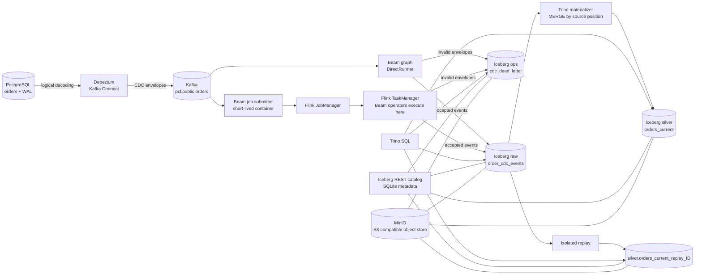
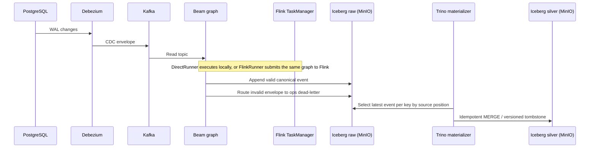

# Portable CDC Lakehouse — Engineering POC

A local, reproducible CDC lakehouse that captures PostgreSQL changes, normalizes them with Scala on the Apache Beam Java SDK, stores append-only history in Apache Iceberg on MinIO, and materializes an auditable current-state table.

The POC exercises the same Beam graph with DirectRunner and with the classic FlinkRunner on a separate Flink JobManager and TaskManager. It is an engineering demonstration, not a production-certified data platform.

> **Current status:** the local stack, bounded Beam-to-Iceberg flow, Flink cluster submission, current-state materialization, and isolated replay are implemented and have runtime evidence. Some SRS acceptance and recovery scenarios remain open; see [SRS status](#srs-completion-status).

## What this POC demonstrates

- PostgreSQL logical decoding through Debezium and Kafka Connect.
- A canonical CDC contract with validation, stable event IDs, source ordering, and dead-letter routing.
- A portable Beam graph running with DirectRunner or the classic FlinkRunner.
- Append-only raw history and a separate Iceberg current-state projection with versioned delete tombstones.
- Replay into a run-specific table without overwriting the canonical projection.
- SQL inspection and reconciliation through Trino.
- A local stack managed by Podman, with pinned versions and manual Rake commands.

## Architecture



### Runtime flow

1. PostgreSQL writes changes to its logical WAL. Debezium reads those changes and publishes envelopes to Kafka.
2. Beam reads the topic, ignores Kafka's null-value delete markers, normalizes Debezium envelopes, and routes valid events to raw history and invalid envelopes to the dead-letter table.
3. With DirectRunner, the Beam process executes locally in its temporary container. With FlinkRunner, that container submits the job; Flink executes the Beam operators in the TaskManager. The submitter is removed after a bounded job finishes, while the Flink services remain available for inspection.
4. Trino runs an idempotent `MERGE` from raw history into `silver.orders_current`, keeping the highest source position per order. Deletes become versioned tombstones.
5. `lakehouse:replay` creates an isolated target table and rebuilds it from all raw events or an inclusive LSN range. It does not update the canonical current-state table.
6. Trino queries inspect the Iceberg tables, snapshots, counts, and reconciliation discrepancies.



## Technology choices

| Technology | Role | Why it is used here |
|---|---|---|
| Scala 2.13 on Beam Java SDK 2.76 | Pipeline code and common transformations | Meets the SRS language choice while using Beam's JVM API. Beam does not provide a separate official Scala SDK; Scala/JVM serialization and runner compatibility are explicit validation concerns. |
| DirectRunner | Local runner | Gives a low-friction path to execute the bounded fixture without a cluster. |
| Flink 2.2.1 + classic FlinkRunner | Distributed runner | Demonstrates a JVM job submitted to a real local JobManager/TaskManager cluster using the same Beam graph. |
| PostgreSQL 17 | Operational source | Provides a familiar relational source and logical WAL for CDC. |
| Debezium 3.2 + Kafka Connect | CDC capture | Converts PostgreSQL WAL changes and snapshots into a standard Kafka topic. |
| Kafka 3.9.1 (KRaft) | Durable event transport | Separates source capture from Beam consumption without adding ZooKeeper to this single-node POC. |
| Apache Iceberg 1.11 | Raw history and table format | Provides append history, table snapshots, and a versioned current-state table on object storage. |
| MinIO | S3-compatible object storage | Required by the SRS; lets Beam and Trino share one local object-store endpoint. The pinned upstream MinIO release is built locally because the upstream community image is no longer published. |
| Iceberg REST fixture 1.10.1 + SQLite | Shared catalog metadata | Gives Beam and Trino a common REST catalog. SQLite catalog metadata persists in a Podman volume. |
| Trino 476 | SQL materialization, inspection, and reconciliation | Runs the Iceberg `MERGE` and provides a direct way to inspect state and snapshots. It is also the reason raw-to-silver materialization stays outside the Beam graph. |
| Podman + Podman Compose | Local services and job containers | Satisfies the container-runtime requirement without Docker Engine and keeps service versions and volumes in `compose.yaml`. |
| Rake | Manual task interface | Encapsulates build, readiness, environment-file generation, pipeline submission, replay, and cleanup behind repeatable commands. Rake tasks are orchestration commands, not extra runtime services. |

### Pinned versions and validation

| Component | Version | Validation |
|---|---|---|
| Podman / podman-compose | 5.8.2 / 1.5.0 | Local stack started and exercised |
| Build image / JDK | `scala-sbt:eclipse-temurin-21.0.12_8_1.13.0_2.13.18` / Temurin 21.0.12+8 | Build and test gate |
| Scala / sbt | 2.13.18 / 1.13.0 | Compile and tests |
| Apache Beam / DirectRunner | 2.76.0 | Bounded Kafka-to-Iceberg run |
| Beam FlinkRunner / Apache Flink | 2.76.0 (`beam-runners-flink-2.2`) / 2.2.1 | Bounded job completed on Podman JobManager and TaskManager |
| PostgreSQL / Kafka | 17.2 / 3.9.1 | Source CDC and topic exercised |
| Debezium Connect | 3.2.4.Final | PostgreSQL connector task reached RUNNING |
| Apache Iceberg / Iceberg REST fixture | 1.11.0 / 1.10.1 | Beam write, Trino read, REST catalog shared |
| Trino | 476 | Table creation, materialization, and SQL inspection |
| MinIO | `RELEASE.2025-10-15T17-29-55Z`, built with Go 1.24.8 | Bucket and Iceberg object writes exercised |
| AWS CLI | 2.27.41 | MinIO bucket bootstrap |

The FlinkRunner artifact family matches Flink 2.2.x, and [Beam's compatibility table](https://beam.apache.org/documentation/runners/flink/) lists support for Beam 2.75.0 and later with that runner family. The compatibility evidence above is specific to this local pinned stack; it does not claim production-cluster validation.

## Data model and semantics

| Table | Purpose | Important behavior |
|---|---|---|
| `raw.order_cdc_events` | Canonical append-only history | Stores source, key, operation, source position, before/after images, snapshot flag, batch ID, and event ID. |
| `silver.orders_current` | Current state for each order | One row per order; latest source position wins; deletes remain as `is_deleted=true` tombstones. |
| `ops.cdc_dead_letter` | Invalid input inspection | Stores the reason code and payload for invalid Debezium envelopes. |
| `silver.orders_current_replay_<id>` | Isolated replay result | A run-scoped target created by `rake lakehouse:replay`; the canonical projection is left untouched. |

Ordering uses LSN and transaction/sequence tie-breakers where available. Event time and arrival time are not used as the sole precedence rule. Snapshot rows are marked distinctly; deterministic event IDs include the primary key because PostgreSQL snapshot rows can share a source position.

## Quick start

The commands below are for Windows PowerShell from the repository root. This README contains setup, replay, and operational instructions.

```powershell
Copy-Item .env.example .env
# Edit .env and set local Postgres and MinIO passwords.

bundle exec rake infra:up
bundle exec rake lakehouse:init
bundle exec rake debezium:register
bundle exec rake debezium:status
bundle exec rake fixtures:scenarios
```

Run the same bounded Kafka fixture with either runner. Use a clean stack or record the history baseline if comparing outputs, because each capture appends to raw history.

```powershell
$env:PCL_MAX_RECORDS = '20'
bundle exec rake pipeline:direct
Remove-Item Env:PCL_MAX_RECORDS

$env:PCL_MAX_RECORDS = '20'
bundle exec rake pipeline:flink
Remove-Item Env:PCL_MAX_RECORDS
```

`pipeline:flink` starts `pcl-flink-jobmanager` and `pcl-flink-taskmanager` and keeps them running after the bounded submission. The Flink dashboard defaults to [http://localhost:8081](http://localhost:8081). The submitter container is temporary; Beam operators execute in the TaskManager.

```powershell
bundle exec rake lakehouse:materialize
bundle exec rake lakehouse:describe
bundle exec rake query:file[sql/reconciliation.sql]
```

Replay into an isolated table (LSN bounds are optional and inclusive):

```powershell
$env:PCL_REPLAY_ID = 'audit1'
$env:PCL_REPLAY_FROM_LSN = '0'
$env:PCL_REPLAY_TO_LSN = '999999999'
bundle exec rake lakehouse:replay
Remove-Item Env:PCL_REPLAY_ID
Remove-Item Env:PCL_REPLAY_FROM_LSN
Remove-Item Env:PCL_REPLAY_TO_LSN
```

Omit both bounds for a full-history reconstruction. A bounded replay writes only events in that LSN interval into a fresh table; it does not represent the complete state at the end of the interval unless that interval includes the required baseline/snapshot events for every key.

Stop services while preserving their volumes; the Flink services are stopped with the stack. `infra:reset` deletes all stack volumes and is destructive.

```powershell
bundle exec rake infra:status
bundle exec rake infra:logs[flink-taskmanager]
bundle exec rake infra:down
```

Use `bundle exec rake -T` to list the operational tasks. Build and local checks are available through `bundle exec rake verify`; CI/CD is intentionally out of scope.

## Observability and evidence

- Beam emits a JSON startup record with `run_id`, source, topic, and status, then reports available Beam counters such as accepted events, rejected events, Kafka tombstones, and Iceberg writer/snapshot counts.
- `rake lakehouse:describe` lists tables and current-state Iceberg snapshots.
- `rake query:file[sql/reconciliation.sql]` reports operation counts, duplicate event IDs, dead-letter reasons, and per-key discrepancies.
- A bounded DirectRunner Kafka-to-Iceberg capture completed and was read back through Trino.
- A bounded classic FlinkRunner job completed in the separate Podman cluster. The recorded run read 15 Kafka records, accepted 13 CDC events, observed 2 tombstones, and wrote one Iceberg snapshot.
- `rake verify` passed with 54 unit and architecture tests. It does not replace the outstanding integration and recovery scenarios listed below.

## SRS completion status

The POC is **not fully closed against the SRS yet**. It demonstrates the core path, but the SRS Definition of Done expects evidence for every AC-01–AC-12 or an explicitly accepted deviation.

| Acceptance criterion | Status | Current evidence / remaining work |
|---|---|---|
| AC-01 CDC capture | Verified | PostgreSQL → Debezium → Kafka fixture exercised. |
| AC-02 canonical contract and invalid-event route | Partial | Normalization/validation unit-tested and pipeline routes to DLQ; an invalid envelope still needs an end-to-end DLQ assertion. |
| AC-03 DirectRunner/FlinkRunner equivalence | Partial | Both runners completed bounded jobs; exact logical outputs have not yet been compared from isolated, identical fixture baselines. |
| AC-04 upsert precedence | Verified for the implemented `orders` materializer | Newer source versions win; reconciliation checks the current projection. |
| AC-05 delete/tombstone | Verified for the implemented fixture | Deletes persist as tombstones; delete-then-reinsert and stale-event rules are covered by domain logic. |
| AC-06 idempotency | Partial | Domain and materializer idempotency are tested; duplicate delivery is not yet an automated end-to-end scenario and raw remains append-only. |
| AC-07 replay reconstruction | Partial | Isolated full/LSN-range replay exists; compare the replay result to the expected reference, including values and tombstones, as a repeatable acceptance check. |
| AC-08 recovery after restart | Pending | Checkpoint/offset and failure-window restart scenarios have not been validated. |
| AC-09 Iceberg snapshots | Verified | Trino can inspect Iceberg tables and snapshots; Beam writes through MinIO. |
| AC-10 Podman operation | Verified | Rake start/status/logs/stop/reset commands and operating instructions are included in this README. |
| AC-11 manual execution | Verified | Build, tests, runners, materialization, replay, and reconciliation are manual Rake tasks. |
| AC-12 documentation and limitations | In progress | This README now consolidates architecture, version pins, commands, decisions, evidence, and known gaps; remaining acceptance evidence is still open. |

### Remaining SRS work

1. Add deterministic duplicate and out-of-order fixture scenarios; prove snapshot-versus-WAL precedence on an isolated dataset.
2. Add an integration check that injects an invalid Debezium envelope and asserts its reason and payload in `ops.cdc_dead_letter`.
3. Compare DirectRunner and FlinkRunner outputs against the same fixture baseline, then reconcile both.
4. Reconcile a replay target by keys, business values, and tombstones; associate the replay ID with the result evidence.
5. Exercise restart/failure windows and define checkpoint/offset behavior. The POC does not claim end-to-end exactly-once.
6. Complete observability for duplicate, obsolete, commit, and discrepancy counters; current logs/counters and SQL reports cover only part of FR-017.
7. Record a documented synthetic-load duration/throughput measurement for NFR-007. No production SLA is implied.

CI/CD, production cloud deployment, HA, Kubernetes, and a production SLA are excluded by the SRS.

## Strengths and trade-offs

| Strength | Trade-off / boundary |
|---|---|
| Raw history, current state, and replay have separate responsibilities. | Raw is append-only and can contain repeated deliveries; logical projection correctness does not deduplicate the history table. |
| Both local and distributed Beam runners use the same application graph. | Compatibility is proven only for this pinned local Podman stack and bounded capture. |
| MinIO, Iceberg REST, Iceberg tables, and Trino run locally. | MinIO is built from a pinned upstream source release; the REST catalog is a POC fixture backed by SQLite. |
| Source positions and delete tombstones protect state ordering. | Recovery/checkpoint semantics and exactly-once behavior across Kafka, Beam, and Iceberg are not claimed. |
| Rake offers repeatable manual operations without CI/CD. | Local resource usage and throughput have not been benchmarked as production characteristics. |

## Repository map

```text
compose.yaml                         Podman services and the optional Flink profile
src/main/scala/.../domain            Pure CDC contract and state rules
src/main/scala/.../adapters          Debezium decoding and normalization
src/main/scala/.../app               Beam pipeline composition and IcebergIO
sql/bootstrap_catalog.sql            Iceberg raw, silver, and ops schemas
sql/materialize_orders.sql           Idempotent current-state MERGE
sql/reconciliation.sql               Counts, tombstones, and discrepancy report
infra/fixtures/                      Deterministic PostgreSQL CDC mutations
rakelib/                             Build, infrastructure, pipeline, replay, and query tasks
```

## License

See [LICENSE](LICENSE).
