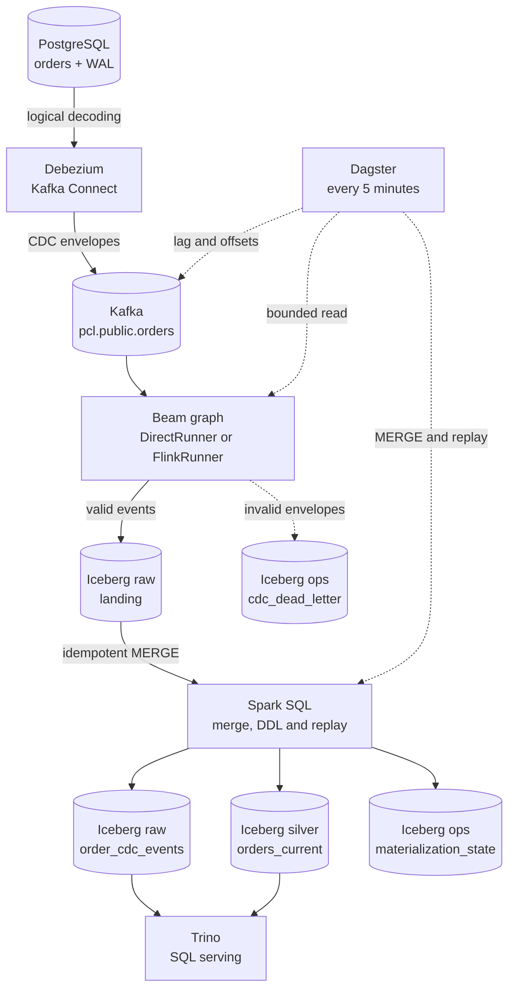
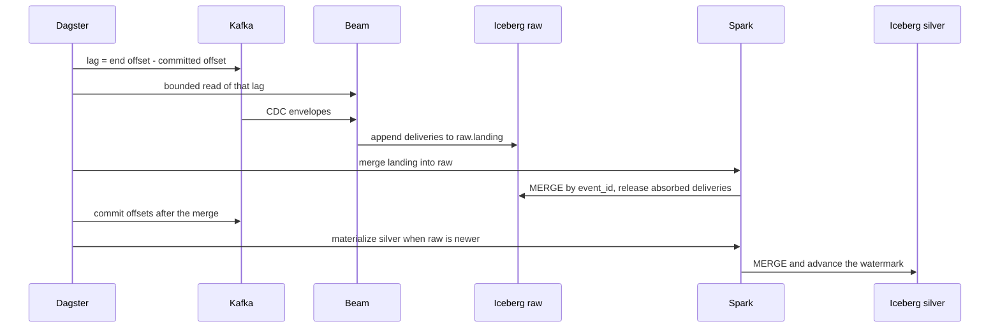

# 🧊 Portable CDC Lakehouse 🚀

### Open-source data engineering experiment with Apache Beam, Apache Spark, Flink and Iceberg

Portable CDC Lakehouse is a local Proof of Concept (POC) for capturing database changes, processing them as a stream, and storing both change history and current state in an open table format.

It uses PostgreSQL, Debezium, Kafka, Scala on the Beam Java SDK, Apache Spark, Apache Flink, Apache Iceberg, Apache Polaris, MinIO, Trino, and Dagster. The same Beam graph runs on DirectRunner and on the classic FlinkRunner with separate JobManager and TaskManager containers. Beam lands accepted events, Spark merges repeated deliveries into one row per event, Dagster runs the incremental graph every five minutes, and Trino serves the results to SQL clients.

## ⚠️ Disclaimer

This repository is an open-source engineering experiment intended for learning and architectural exploration. It is a POC, not a production-ready data platform. It does not provide production availability, security hardening, recovery guarantees, performance SLAs, or end-to-end exactly-once delivery.

## 🎯 Project goal

The goal is to make the path from a relational database change to an auditable lakehouse table visible and reproducible. The POC focuses on the boundaries that are easy to get wrong in streaming systems: CDC envelope normalization, source-position ordering, duplicate delivery, delete tombstones, replay, the interaction between Beam runners and Iceberg storage, and the separation between batch transformation and serving.

## ⚖️ Why this architecture

PostgreSQL answers *what is the state now*. This POC also answers *how did it get here, and can I rebuild it*.

| Question | Querying PostgreSQL directly | This POC |
|---|---|---|
| What is the current state? | Yes, simple and fast | Yes, in `silver` |
| What changed, and when? | No, only the live row | Yes, canonical `raw` history with before/after images |
| What happened to deleted rows? | No, they are gone | Yes, versioned tombstones |
| Can I reprocess after a rule or bug fix? | No, the changes are lost | Yes, rebuild `silver` from `raw` |
| Can analytics run without loading the operational database? | No, they compete with the application | Yes, Trino and Iceberg |
| Can several consumers read the same stream? | No, they couple to the database | Yes, one Kafka stream, many readers |
| Can I read the table as of a past snapshot? | No | Yes, Iceberg snapshots |

The point is not to read better: it is to **reconstruct, audit, and analyze without touching the operational system**.

The trade-off is explicit: more moving parts (Kafka, Flink, Spark, Iceberg, Polaris, Trino), seconds of latency, and a transient landing buffer. For a small dataset that only needs the current row, a direct `SELECT` is the better engineering choice.

## ✨ Key highlights

- 🐘 Capture PostgreSQL changes from the WAL with Debezium.
- 📨 Publish CDC events to Kafka and consume them with a Beam graph.
- 🔀 Run the graph with DirectRunner or submit it to a separate Flink cluster.
- 🧾 Keep canonical CDC history in Iceberg on MinIO, one row per event.
- 🪦 Project the history into one current-state row per order, preserving deletes as versioned tombstones.
- ♻️ Merge repeated deliveries into canonical `raw` by `event_id` before materializing.
- ⚡ Transform with Spark SQL: idempotent landing and projection `MERGE`, DDL, and replay.
- 🗓️ Run the incremental graph on a Dagster schedule, with asset checks gating each run.
- 🔁 Replay raw history into an isolated Iceberg table.
- 🔎 Serve with Trino, decoupled from ingestion and transformation.
- 📦 Run local dependencies with Podman; operate the POC through Rake commands.

## 🏗️ Architecture



Polaris serves the Iceberg catalog and MinIO stores the data files for every table above; Trino also reads `ops.cdc_dead_letter` and `ops.materialization_state`. Beam appends every delivery to `raw.order_cdc_events_landing`; Spark merges one row per `event_id` into canonical `raw`, then materializes `silver` from it. Replay writes `silver.orders_current_replay_ID`, an isolated table that the diagram omits for clarity.

### 🔄 Runtime flow

1. Dagster's five-minute schedule starts a run. The run compares the topic's end offsets with the consumer group's committed offsets, so it knows exactly how many records are pending before starting anything.
2. PostgreSQL writes changes to its logical WAL. Debezium reads those changes and publishes envelopes to Kafka.
3. Beam reads the topic, ignores Kafka's null-value delete markers, normalizes Debezium envelopes, and routes valid events to `raw.order_cdc_events_landing` and invalid envelopes to the dead-letter table. The landing table accepts every delivery, duplicates included.
4. With DirectRunner, the Beam process executes locally in its temporary container. With FlinkRunner, that container submits the job and waits while Flink executes Beam operators in the TaskManager. The streaming job checkpoints every 10 seconds with RocksDB and externalized checkpoints, so a restart has a durable state snapshot. In continuous mode, the submitter and Flink services stay active until the job is stopped.
5. Spark merges the landing table into canonical `raw`: it keeps the newest delivery per `event_id`, inserts only events that are not already in `raw`, and releases the deliveries that `raw` now holds. Cleanup is keyed on `raw`, not on a timestamp, so a delivery that arrives during the merge is only dropped when it duplicates an event already stored; a new event waits for the next run. Dagster commits the Kafka offsets only after this merge, so a crash before it re-reads the records and the merge absorbs them.
6. Spark SQL materializes `silver.orders_current` from canonical `raw`. It reads the watermark from `ops.materialization_state`, selects the keys that received arrivals since the last run, re-ranks the full history of only those keys, applies an idempotent `MERGE`, and advances the watermark after the commit. Deletes become versioned tombstones. A run with no raw event newer than the watermark skips Spark entirely.
7. `lakehouse:replay` and `dagster:replay` drop and recreate an isolated target table with Spark and rebuild it from all raw events or an inclusive LSN range. They do not update the canonical current-state table or the watermark.
8. Trino serves the lakehouse: it inspects canonical `raw`, `silver` and snapshots and answers reconciliation and business queries, separately from ingestion and transformation.

The scheduled run, from the orchestrator's point of view:



The sequence shows the orchestrator's view of one scheduled run; PostgreSQL and Debezium keep filling Kafka in the background. The unbounded Flink path uses the same Beam graph: the submitter container hands it to the JobManager and TaskManager, which execute it continuously and checkpoint every 10 seconds.

## 🧰 Technologies and why they were chosen

### 🐘 PostgreSQL — operational source

PostgreSQL represents the application database whose changes need to reach the lakehouse. Its logical WAL gives Debezium a change stream to capture, while the sample `orders` table keeps the POC grounded in normal relational data. The current implementation focuses on one PostgreSQL source and the `orders` entity.

### 🔌 Debezium and Kafka Connect — CDC capture

Debezium reads the PostgreSQL WAL and emits structured change envelopes, including an initial snapshot and subsequent creates, updates, and deletes. This avoids implementing a custom database poller and gives the pipeline source metadata it can use for ordering. Kafka Connect hosts and manages the connector.

### 📨 Apache Kafka — decoupled event transport

Kafka buffers the CDC stream between the source connector and Beam. This lets capture and processing run independently and gives consumers a replayable topic. The local broker uses KRaft, so the single-node POC does not need ZooKeeper. This setup demonstrates the integration path; it is not a highly available Kafka deployment.

### 🧠 Scala and Apache Beam — shared processing graph

The pipeline is written in Scala 2.13 using Beam's Java SDK. Beam provides one graph for reading Kafka, normalizing and validating events, routing invalid input, and writing accepted rows to the landing table. Keeping those transforms in a Beam graph makes runner portability demonstrable. Beam does not publish a separate official Scala SDK, so Scala/JVM serialization and classloading are explicit compatibility concerns in this POC.

### 🏃 DirectRunner and FlinkRunner — local and distributed execution

DirectRunner executes the graph locally and is useful during development. The classic FlinkRunner submits the same JVM graph to the local Flink JobManager; Flink schedules and executes the operators in the TaskManager. This makes the persistent distributed runtime visible in Podman while keeping the business transforms shared. A separate Beam worker service is not required for this classic JVM runner. The continuous job runs on the Flink cluster with checkpointing; result-by-result equivalence between the two runners is not claimed.

### ⚡ Apache Spark — batch transformation layer

Spark owns every canonical write: it merges the landing deliveries into `raw` by `event_id`, maintains `silver`, and rebuilds replay targets. It runs as a one-shot `spark-sql` container on the Compose network, so the POC needs no long-lived cluster; the image is built once with the Iceberg runtime baked in. This keeps Beam focused on streaming ingestion and Spark on set-based table maintenance, and the portable artifact is the SQL rather than a runner.

### 🧊 Apache Iceberg — open table format

Iceberg stores the transient landing buffer, the canonical event history, and the current-state projection. The landing table accepts every delivery; `raw` keeps one row per event; `silver` holds one row per order and records deletes as versioned tombstones, so older changes cannot silently restore a deleted order. Beam appends to landing, Spark writes `raw` and `silver`, and Trino reads the canonical tables. Iceberg snapshots make committed table changes inspectable.

### 🗄️ MinIO — local S3-compatible object storage

MinIO gives Beam, Spark and Trino a shared S3 API endpoint without requiring a cloud account. Iceberg data files live in its persistent Podman volume. The POC builds a pinned upstream MinIO release locally, so the binary and the image are reproducible and the version does not drift.

### 📚 Apache Polaris — shared Iceberg REST catalog

Beam, Spark and Trino resolve the same Iceberg tables and snapshots through one REST catalog endpoint. Apache Polaris provides that endpoint, and its metadata lives in a dedicated `polaris` database inside the same PostgreSQL instance as the source (schema `polaris_schema`), so catalog state survives container restarts and needs no separate store. Clients authenticate with OAuth2 client credentials and use their own S3 credentials for data files, since MinIO does not provide STS.

### 🔎 Trino — SQL serving layer

Trino is the SQL serving layer: it reads the Iceberg tables through Polaris and answers business queries, snapshot inspection and reconciliation without loading PostgreSQL. Running it separately from Spark keeps interactive queries away from ingestion and batch transformation, and any SQL client can use it through the standard Trino endpoint.

### 🗓️ Dagster — scheduled orchestration

Dagster is the scheduled entrypoint: every five minutes it runs the same pinned Spark and Beam containers the Rake tasks run, so there is no second implementation. Each run measures the Kafka lag, reads only that many records into landing, merges them into canonical `raw`, and commits the offsets after the merge; when nothing arrived and landing is empty, it skips both JVMs instead of rewriting `silver`. Three asset checks gate each run, and run history lives in a `dagster` database in the same PostgreSQL instance. Replay stays explicit: `rake dagster:replay[id,from_lsn,to_lsn]`.

### 📦 Podman, Compose, and Rake — reproducible local operations

Podman runs the services and job containers without requiring Docker Engine. Compose describes the pinned services, named data volumes, and optional Flink cluster. Rake provides repeatable commands for startup/readiness, builds, pipeline submission, replay, queries, and shutdown. Dagster owns the unattended path; these tasks remain the manual and test path.

### 📌 Pinned versions and validation

| Component | Version | Validation |
|---|---|---|
| Podman / podman-compose | 5.8.2 / 1.5.0 | Local stack started and exercised |
| Build image / JDK | `scala-sbt:eclipse-temurin-21.0.12_8_1.13.0_2.13.18` / Temurin 21.0.12+8 | Build and test gate |
| Scala / sbt | 2.13.18 / 1.13.0 | Compile and tests |
| Apache Beam / DirectRunner | 2.76.0 | Bounded Kafka-to-Iceberg run |
| Beam FlinkRunner / Apache Flink | 2.76.0 (`beam-runners-flink-2.2`) / 2.2.1 | Bounded job completed on Podman JobManager and TaskManager |
| Apache Spark | 3.5.9 (Scala 2.12, Java 17) | Landing→raw MERGE, silver MERGE, replay |
| Iceberg Spark runtime / AWS bundle | 1.11.0 | Baked into the Spark image, no runtime downloads |
| PostgreSQL / Kafka | 17.2 / 3.9.1 | Source CDC and topic exercised |
| Debezium Connect | 3.2.4.Final | PostgreSQL connector task reached RUNNING |
| Apache Iceberg | 1.11.0 | Beam landing write, Spark merge, Trino read |
| Apache Polaris | 1.8.0 | OAuth2 catalog API, Postgres metastore, MinIO storage |
| Trino | 476 | Serving queries, reconciliation, snapshot inspection |
| Dagster / dagster-postgres | 1.13.27 / 0.29.27 (Python 3.12, SQLAlchemy 2.0.55) | Scheduled runs, idempotent merge, asset checks, Postgres-backed history |
| confluent-kafka (Dagster image) | 2.16.0 | Consumer-group lag measurement and offset commit |
| MinIO | `RELEASE.2025-10-15T17-29-55Z`, built with Go 1.24.8 | Bucket and Iceberg object writes exercised |
| AWS CLI | 2.27.41 | MinIO bucket bootstrap |

The FlinkRunner artifact family matches Flink 2.2.x, and [Beam's compatibility table](https://beam.apache.org/documentation/runners/flink/) lists support for Beam 2.75.0 and later with that runner family. The compatibility evidence above is specific to this local pinned stack; it does not claim production-cluster validation.

## 🗂️ Data model and semantics

| Table | Purpose | Important behavior |
|---|---|---|
| `raw.order_cdc_events_landing` | Ingest buffer | Beam appends every delivery here, duplicates included. Spark merges the rows into canonical `raw` and releases the ones `raw` now holds, so the buffer is transient. |
| `raw.order_cdc_events` | Canonical event history | One row per `event_id`. Stores source, key, operation, source position, before/after images, snapshot flag, `source_timestamp`, `connector_timestamp`, `raw_reference` (`topic:partition:offset`), batch ID, and event ID. |
| `silver.orders_current` | Current state for each order | One row per order; latest source position wins; deletes remain as `is_deleted=true` tombstones; `last_operation` and `last_source_timestamp` describe the winning event. |
| `ops.cdc_dead_letter` | Invalid input inspection | Stores the reason code and payload for invalid Debezium envelopes. |
| `ops.materialization_state` | Incremental watermark | One row per target table; `last_ingested_at` is the arrival bound already folded into the projection. |
| `silver.orders_current_replay_<id>` | Isolated replay result | A run-scoped target created by `rake lakehouse:replay`; the canonical projection is left untouched. |

Ordering uses LSN, then the numeric transaction id, then the intra-transaction `sequence` ordinal, then the deterministic event id. Event time and arrival time are not used as the sole precedence rule. Snapshot rows are marked distinctly; deterministic event IDs include the primary key because PostgreSQL snapshot rows can share a source position.

Beam appends every delivery to `raw.order_cdc_events_landing`. Spark merges that buffer into `raw.order_cdc_events` with `MERGE ... ON event_id`, so repeated delivery is absorbed at ingest and canonical `raw` holds one row per event. The merge keeps the newest delivery per event, inserts only unseen events, releases the deliveries that `raw` already holds, and also removes older copies left by earlier runs. Reconciliation asserts the invariant: zero duplicated event ids.

`lakehouse:merge` runs the landing→raw merge. `lakehouse:materialize` runs it first, then the incremental projection: it uses `ingested_at` (arrival) to find the keys that changed since the last successful run and re-ranks the full history of only those keys. Source order still decides the winner, so a late event cannot overwrite a newer state. The watermark advances after the `MERGE` commits; a failed run is reprocessed, and the `MERGE` is idempotent. A replay is a full rebuild by definition and never touches the watermark.

## 🚀 Quick start

From Windows PowerShell, copy `.env.example` to `.env`, set the local PostgreSQL, MinIO, and Polaris passwords, and point `PCL_HOST_WORKSPACE` and `PCL_PODMAN_SOCKET` at this machine (Dagster starts Spark and Beam through the host engine). Start the services and prepare the CDC source:

```powershell
Copy-Item .env.example .env
bundle exec rake infra:up          # starts the stack and the Dagster daemon
bundle exec rake lakehouse:init    # Spark creates the raw, landing, silver and ops tables
bundle exec rake debezium:register # registers the PostgreSQL connector
bundle exec rake fixtures:scenarios
```

`infra:up` starts PostgreSQL first, ensures the `polaris` and `dagster` databases and `polaris_schema` exist, then starts the rest of the stack and finally the Dagster daemon. The one-shot `polaris-setup` container creates the `pcl` catalog idempotently. Polaris listens on `http://localhost:8181/api/catalog`; its health endpoint is `http://localhost:8182/q/health`. The first `lakehouse:init` builds the pinned Spark image locally; later runs reuse it.

The Dagster schedule is already running and performs the same initialization and incremental steps every five minutes, so the explicit commands above only make the first result immediate. The UI is at [localhost:3000](http://localhost:3000): `rake dagster:run` triggers the same job on demand, and `rake dagster:replay[readme_proof]` runs a replay through Dagster.

Launch the unbounded Beam job. It keeps reading CDC events from Kafka and writing them to Iceberg until you stop the Flink cluster:

```powershell
$env:PCL_MAX_RECORDS = '0'
bundle exec rake pipeline:flink
```

This command stays attached while the job runs. Open the Flink dashboard at [localhost:8081](http://localhost:8081). To stop the job from a second PowerShell window, run `bundle exec rake pipeline:flink:stop`. The continuous job and Dagster share the `pcl-pg-local-1` consumer group, so run one at a time: stop the scheduler with `bundle exec rake dagster:down` before starting the unbounded job.

The `silver.orders_current` projection is refreshed by Dagster every five minutes. `bundle exec rake lakehouse:materialize` runs the landing→raw merge and the same Spark script by hand when you want the update immediately; `bundle exec rake query:file[sql/trino/reconciliation.sql]` then inspects the result. While the unbounded Beam job runs, deliveries accumulate in `raw.order_cdc_events_landing`; stop the job and run `bundle exec rake lakehouse:merge` before querying canonical `raw` or `silver`.

## 📸 Results

The stack runs end to end: PostgreSQL changes reach Kafka, Beam lands them in Iceberg, Spark merges one row per event and maintains the current-state projection, and Trino reads it. Each subsection shows one capability with the output that proves it.

### 1. Apache Polaris owns the catalog

`rake infra:up` starts PostgreSQL first, creates the `polaris` database and schema, bootstraps the `POLARIS` realm, creates the `pcl` catalog, grants the content privilege and catalog setting that drop-with-purge needs, and only then starts Trino. Every step is idempotent:

```text
$ rake infra:up
Created MinIO bucket 'pcl-warehouse'.

All services ready.
  Trino    http://localhost:8080
  Connect  http://localhost:8083
  MinIO    http://localhost:9001
  Polaris  http://localhost:8181/api/catalog
  Polaris health  http://localhost:8182/q/health
  Dagster  http://localhost:3000
```

```text
$ podman logs pcl-polaris-bootstrap
Realm 'POLARIS' successfully bootstrapped.
Bootstrap completed successfully.

$ podman logs pcl-polaris-setup
Requesting a Polaris access token...
Polaris catalog 'pcl' already exists.
Polaris catalog role 'catalog_admin' already holds CATALOG_MANAGE_CONTENT.
Polaris catalog 'pcl' already enables drop-with-purge.
```

The setup is idempotent: a re-run reports that the catalog and its grants already exist.

The realm is stored in PostgreSQL, and the health endpoint reports `UP`:


### 2. Both runners process the same CDC stream

Debezium reports the connector and its single task as `RUNNING`:

```json
{"name":"pcl-postgres-orders","connector":{"state":"RUNNING"},"tasks":[{"id":0,"state":"RUNNING"}],"type":"source"}
```

The bounded DirectRunner pass read 21 Kafka records: 15 valid events, 4 deliberately invalid envelopes that became dead letters, and 2 Kafka tombstones (the key-only delete markers Debezium emits, which carry no payload). It wrote one Iceberg data file:

```text
elements_read=21  accepted_events=15  rejected_events=4  kafka_tombstones=2  dataFilesWritten=1
```

The FlinkRunner pass ran the same graph on the same topic and produced the same 15 accepted events. Repeated passes re-read whatever the consumer group has not committed, but they append to the landing table, not to canonical history. Two bounded passes over the same 21 records left 30 deliveries for 15 distinct events; the merge absorbed the duplicates, left canonical `raw` unchanged at 15 rows, and drained the buffer:

```text
$ rake lakehouse:merge
landing_rows	30
landing_events	15
landing_duplicates	15
raw_rows	15
raw_event_ids	15
landing_remaining	0
```

Canonical `raw` therefore holds one row per event, and the projection reads it without a dedup step.

The same job also runs continuously on Flink, where it accumulates checkpoints:


85 checkpoints completed and written to the external directory, so a restart resumes from durable state:


### 3. Spark materializes through Polaris

`rake lakehouse:init` creates the namespaces and tables with a one-shot `spark-sql` container. `rake lakehouse:materialize` first merges landing into canonical `raw` and then applies the incremental projection `MERGE`. Both talk to the same Polaris REST catalog as Beam and Trino:

```text
$ rake lakehouse:init
$ podman run --rm --network pcl_default ... localhost/pcl-spark:3.5.9-iceberg-1.11.0 \
    /opt/spark/bin/spark-sql --properties-file /opt/pcl/conf/spark-defaults.conf -f /opt/pcl/conf/work/bootstrap_catalog.sql
Spark master: local[*], Application Id: local-1793215973901
Time taken: 10.077 seconds
Time taken: 0.187 seconds
Time taken: 0.235 seconds
Time taken: 6.058 seconds
Time taken: 1.804 seconds
Time taken: 0.303 seconds
Time taken: 0.205 seconds
Time taken: 0.181 seconds
Iceberg tables ready (spark-sql, catalog pcl).
```

The first materialization reads the watermark (epoch) and scans every key; later runs rescan only the keys with new arrivals. Because the `MERGE` is idempotent, a repeated batch converges on the same result, but it is not free: Spark rewrites the files that contain matched rows and commits an overwrite snapshot even when no business value changes. The capture below ran with an empty landing table and still re-ranked the one key sitting exactly on the watermark boundary, which the `>=` detection window re-checks on purpose.

```text
$ rake lakehouse:materialize
$ podman run --rm --network pcl_default ... localhost/pcl-spark:3.5.9-iceberg-1.11.0 \
    /opt/spark/bin/spark-sql --properties-file /opt/pcl/conf/spark-defaults.conf -f /opt/pcl/conf/work/merge_raw.sql
Spark master: local[*], Application Id: local-1793221071539
Time taken: 5.575 seconds
Time taken: 17.84 seconds
Time taken: 0.5 seconds
Time taken: 6.127 seconds
landing_rows	0
landing_events	0
landing_duplicates	0
raw_rows	18
raw_event_ids	18
landing_remaining	0
Raw history merged (spark-sql, catalog pcl).

$ podman run --rm --network pcl_default ... localhost/pcl-spark:3.5.9-iceberg-1.11.0 \
    /opt/spark/bin/spark-sql --properties-file /opt/pcl/conf/spark-defaults.conf -f /opt/pcl/conf/work/materialize_orders.sql
Spark master: local[*], Application Id: local-1793221152831
Time taken: 8.759 seconds
Time taken: 0.318 seconds
Time taken: 0.71 seconds
Time taken: 1.273 seconds
Time taken: 2.111 seconds
changed_keys	1
projected_keys	1
Time taken: 28.228 seconds
Time taken: 6.212 seconds
Current-state projection refreshed (spark-sql, catalog pcl).
```

```text
$ rake lakehouse:describe

== tables
ops | cdc_dead_letter
ops | materialization_state
raw | order_cdc_events
raw | order_cdc_events_landing
silver | orders_current
silver | orders_current_replay_readme_proof
silver | orders_current_replay_window_probe

== current-state snapshots
8420377990516329023 | overwrite | 2026-10-28 21:01:20.125 UTC
6237484225022081417 | overwrite | 2026-10-28 20:53:59.581 UTC
2887277163017433748 | overwrite | 2026-10-28 20:40:59.072 UTC
2342165614340389472 | overwrite | 2026-10-28 20:37:23.509 UTC
4503210802233713410 | overwrite | 2026-10-28 20:17:39.862 UTC
4709231253593627168 | overwrite | 2026-10-27 21:53:30.220 UTC
8028985869781163391 | overwrite | 2026-10-27 21:44:26.723 UTC
4705716679392310919 | overwrite | 2026-10-27 20:15:40.567 UTC
1414936190202702993 | overwrite | 2026-10-27 19:58:06.729 UTC
1580568179560580880 | overwrite | 2026-10-27 19:47:57.356 UTC
319887680504692394 | overwrite | 2026-10-27 19:45:20.538 UTC
6413925175051381393 | append | 2026-10-27 19:36:03.249 UTC

== materialization watermark
silver.orders_current | 2026-10-28 20:50:45.807 UTC | 2026-10-28 21:01:20.942 UTC

== raw invariants
raw_rows | 18
landing_rows | 0
raw_event_ids | 18
```

`lakehouse:describe` reads those tables, snapshots, the watermark and the raw invariants through Trino, the same endpoint any SQL client uses.

Polaris prefixes each table location with a UUID. The raw table's Parquet and metadata files are visible in the MinIO object browser:


### 4. Reconciliation and replay

Reconciliation asserts that canonical `raw` has no duplicate event ids and reports the landing backlog; both are zero. The projection still matches the history key by key:

```text
-- 1. Live vs deleted split of the projection.
false | 6
true  | 1

-- 2. Raw uniqueness invariant. Spark merges landing deliveries by event_id, so
0 | 0

-- 3. Landing backlog. Rows wait here only between the Beam append and the
0 | 0

-- 6. Discrepancy report.
1001 | 39108792 | 39108792 | UPDATE | UPDATE | false | false | ok
1002 | 48907840 | 48907840 | UPDATE | UPDATE | false | false | ok
1003 | 49882848 | 49882848 | UPDATE | UPDATE | false | false | ok
1004 | 31464816 | 31464816 | DELETE | DELETE | true | true | ok
1005 | 31464960 | 31464960 | CREATE | CREATE | false | false | ok
1006 | 31465512 | 31465512 | CREATE | CREATE | false | false | ok
1007 | 47819440 | 47819440 | UPDATE | UPDATE | false | false | ok
```

A full replay into an isolated table reproduces the live projection exactly:

```text
$ $env:PCL_REPLAY_ID='readme_proof'; rake lakehouse:replay
Replay readme_proof materialized to pcl.silver.orders_current_replay_readme_proof: 7 keys, 1 tombstones.
Full replay readme_proof matches silver.orders_current exactly.
```

A bounded replay applies the same logic to an inclusive LSN window, so the target holds only the keys that changed inside it:

```text
$ $env:PCL_REPLAY_ID='window_probe'
$ $env:PCL_REPLAY_FROM_LSN='31464100'; $env:PCL_REPLAY_TO_LSN='31465000'
$ rake lakehouse:replay
Replay window_probe materialized to pcl.silver.orders_current_replay_window_probe: 5 keys, 1 tombstones.
```

```text
SELECT order_id, status, is_deleted, last_lsn
  FROM iceberg.silver.orders_current_replay_window_probe ORDER BY order_id;

1001 | PAID | false | 31464144
1002 | PAID | false | 31464704
1003 | NEW  | false | 31464104
1004 |      | true  | 31464816
1005 | NEW  | false | 31464960
```

Orders 1006 and 1007 are absent because their events fall outside the window. A bounded replay is a partial history by construction, so `lakehouse:replay` reports its shape instead of asserting equality with the live projection.

### 5. Invalid envelopes are quarantined, not dropped

Four deliberately invalid envelopes were published to the same Kafka topic: truncated JSON, an unknown `op`, a delete with no row image, and an update with no primary key. `infra/fixtures/invalid_envelopes.jsonl` holds them, so the check is reproducible:

```powershell
Get-Content infra/fixtures/invalid_envelopes.jsonl |
  podman exec -i pcl-kafka /opt/kafka/bin/kafka-console-producer.sh `
    --bootstrap-server localhost:9092 --topic pcl.public.orders
$env:PCL_MAX_RECORDS = '25'; bundle exec rake pipeline:direct
```

When the four envelopes were first published the topic held 19 records; that bounded pass accepted 13 and rejected 4:

```text
elements_read=19  accepted_events=13  rejected_events=4  kafka_tombstones=2  dataFilesWritten=1
```

Each rejection keeps a stable reason code, the original payload, and the run that observed it:

```text
-- 8. Dead letter overview, by reason code.
INCONSISTENT_PAYLOAD | 1
MALFORMED_JSON       | 1
MISSING_PRIMARY_KEY  | 1
UNKNOWN_OPERATION    | 1

MALFORMED_JSON       | - | {"op":"c","after":
UNKNOWN_OPERATION    | - | {"op":"x","after":{"order_id":9001,"status":"GHOST"}
INCONSISTENT_PAYLOAD | - | {"op":"d","source":{"db":"pcl","schema":"public","ta
MISSING_PRIMARY_KEY  | - | {"op":"u","after":{"status":"NO_KEY"},"source":{"db"
```

`event_id` is empty on purpose: the envelope never reached identity derivation, so there is no canonical id to attach. The payload and the Kafka reference are what make the record diagnosable, and none of the four reached `raw` or `silver`.

### 6. Dagster runs the pipeline unattended

The schedule is created in `RUNNING` state, so `rake infra:up` starts orchestrating without a manual trigger:

```text
$ podman exec pcl-dagster-daemon dagster schedule list -w /opt/dagster/app/workspace.yaml
Repository __repository__
*************************
Schedule: pcl_incremental_every_five_minutes [RUNNING]
Cron Schedule: */5 * * * *
```

Two `UPDATE` statements reached PostgreSQL with no manual trigger; the next tick measured a lag of two records, read them into landing, merged them into canonical `raw`, committed offset 24, and materialized the keys that had arrived since the watermark:

```text
... raw_cdc_events - Reading 2 pending records from pcl.public.orders.
... raw_cdc_events - Committed offsets {0: 24} after the merge.
... raw_cdc_events_batch_fully_accounted - Asset check 'batch_fully_accounted' on 'raw_cdc_events' passed. Description: '2 of 2 records were accepted, quarantined, or delete markers.'
... raw_cdc_events_raw_events_unique - Asset check 'raw_events_unique' on 'raw_cdc_events' passed. Description: '0 event ids appear more than once in raw.'
... orders_current_projection_matches_history - Asset check 'projection_matches_history' on 'orders_current' passed. Description: '0 keys disagree with the history.'
... RUN_SUCCESS - Finished execution of run for "pcl_incremental".
```

The metadata the run recorded:

| Asset | Metadata | Value |
|---|---|---|
| `raw_cdc_events` | pending / read / accepted | 2 / 2 / 2 |
| `raw_cdc_events` | rejected / tombstones / data files written | 0 / 0 / 1 |
| `raw_cdc_events` | landing rows / events / duplicates | 2 / 2 / 0 |
| `raw_cdc_events` | raw rows / raw event ids / landing remaining | 18 / 18 / 0 |
| `orders_current` | pending raw events | 2 |
| `orders_current` | changed / projected keys | 3 / 3 |
| `orders_current` | watermark | `2026-10-28 20:50:45.807345 UTC` |
| `orders_current` | projection keys (live / tombstone) | 7 (6 / 1) |

Three keys were re-ranked, not two: the two orders that changed and the key sitting exactly on the previous watermark, which the `>=` detection window re-checks on purpose.

The following tick found nothing new and skipped both JVMs:

```text
... raw_cdc_events - No pending records for pcl.public.orders.
... orders_current - No raw events since the watermark; skipping the MERGE.
... RUN_SUCCESS - Finished execution of run for "pcl_incremental".
```

The run queue serializes ticks (`max_concurrent_runs: 1` in `infra/dagster/dagster.yaml`): a tick that fires while a merge is still running waits for it instead of writing the landing table concurrently.


Replay is not scheduled. `rake dagster:replay` runs the same Spark script through the same container, with an optional inclusive LSN window:

```text
$ rake "dagster:replay[readme_proof]"
... orders_current_replay - Full replay readme_proof matches silver.orders_current exactly.
... RUN_SUCCESS - Finished execution of run for "pcl_replay".
```

### 7. Terminal evidence

A single capture of the commands behind the state above:


### What this shows

- **One source of truth.** Every engine resolves the same Iceberg tables through Polaris, so history, projection and replay cannot drift apart.
- **Idempotent ingest.** Beam lands every delivery, and Spark merges one row per `event_id` into canonical `raw`; repeated delivery never accumulates there, and a uniqueness check fails the run if it ever does.
- **Portable processing.** The same Beam graph runs locally and on Flink, and the transformation is plain SQL that Spark executes.
- **Auditable by construction.** Canonical history keeps one row per event, deletes stay as tombstones, and reconciliation plus a full replay must agree with the live projection.
- **Unattended and guarded.** Dagster runs the graph on a schedule, commits offsets only after a complete read and the canonical merge, and a failed check stops the run.

This is a **proof of concept**, not a production-ready platform. Restart/recovery behavior is exercised at the checkpoint-configuration level, not through a sustained failure-injection campaign. The landing→raw merge is a scheduled Spark batch, not a continuously running upsert sink; a production deployment would use an exactly-once Iceberg upsert sink or a dedicated merge service. The scheduler is a single cron job with three asset checks: it has no retry policy, backfill UI, or alerting, and its daemon is one process, so scheduled runs have a single point of failure. Performance benchmarking, schema evolution, and a second source table remain unvalidated. Exactly-once processing and production throughput are not claimed.

## 📜 License

See [LICENSE](LICENSE).
