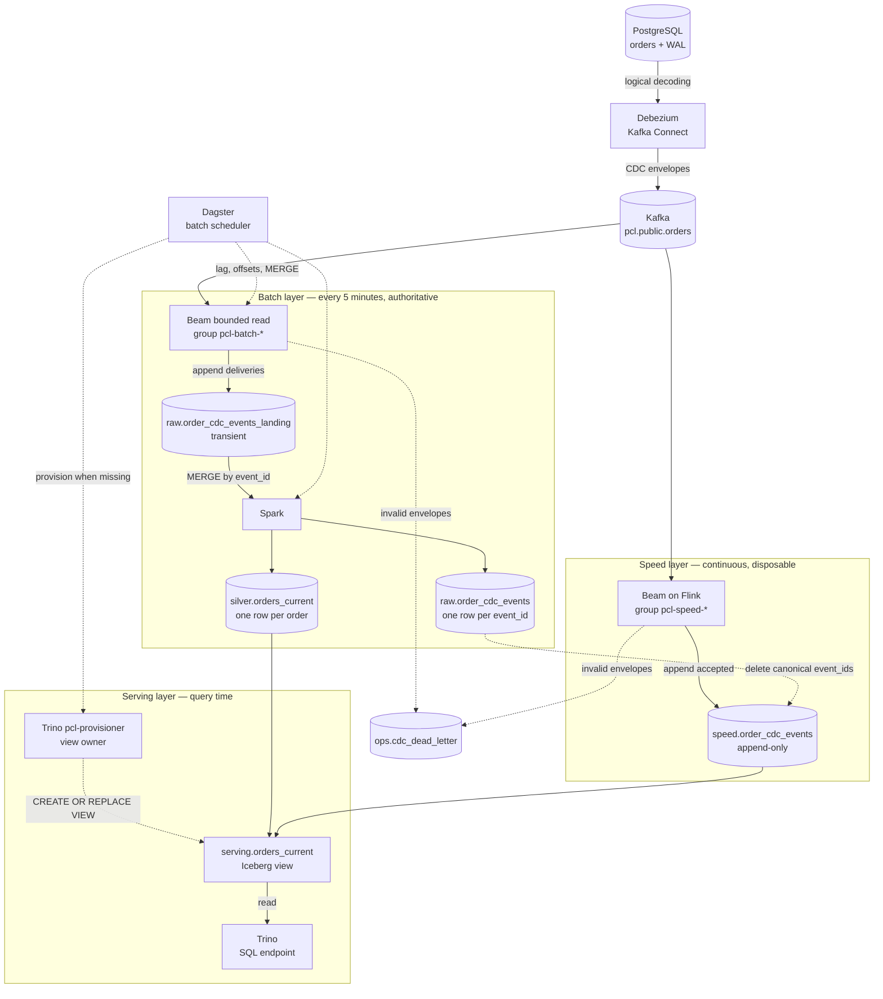
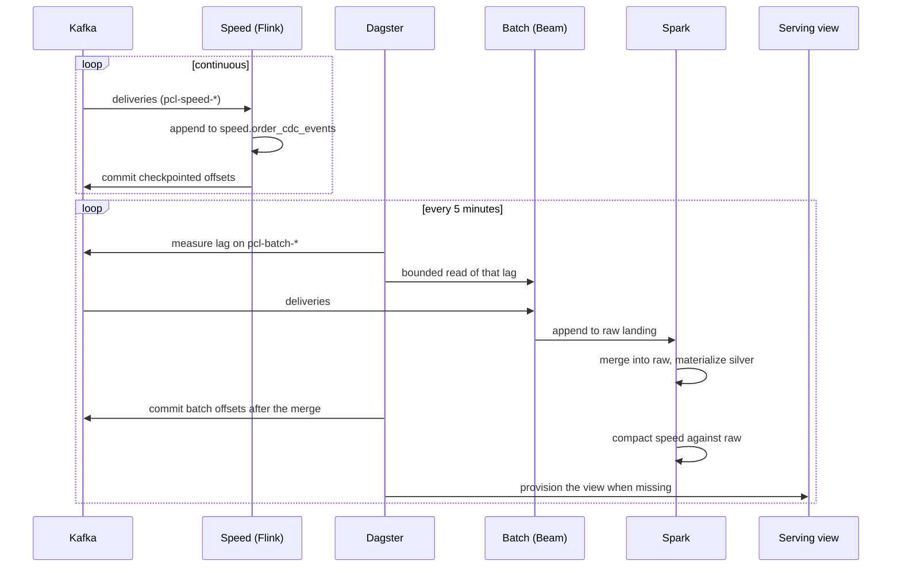
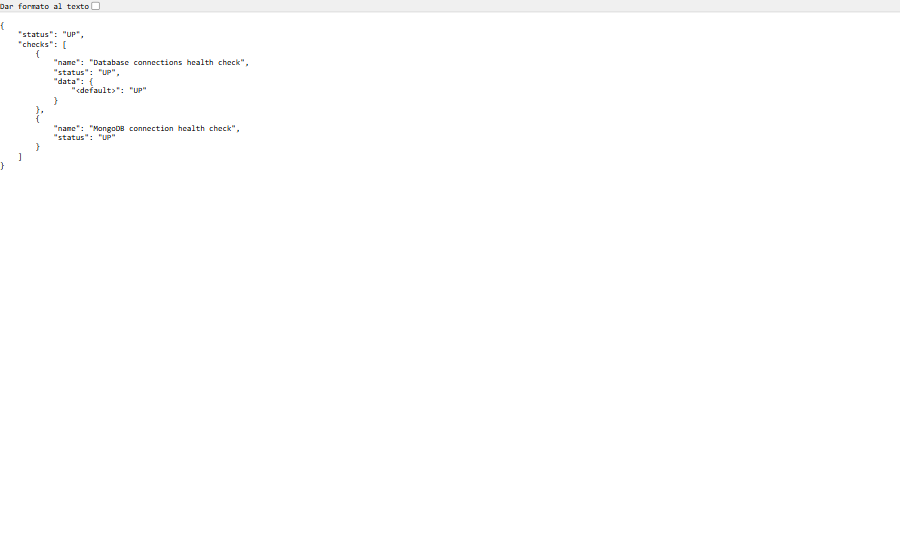
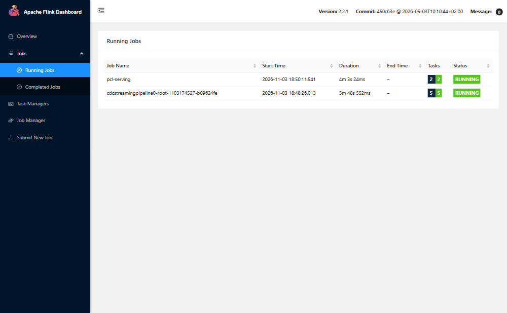
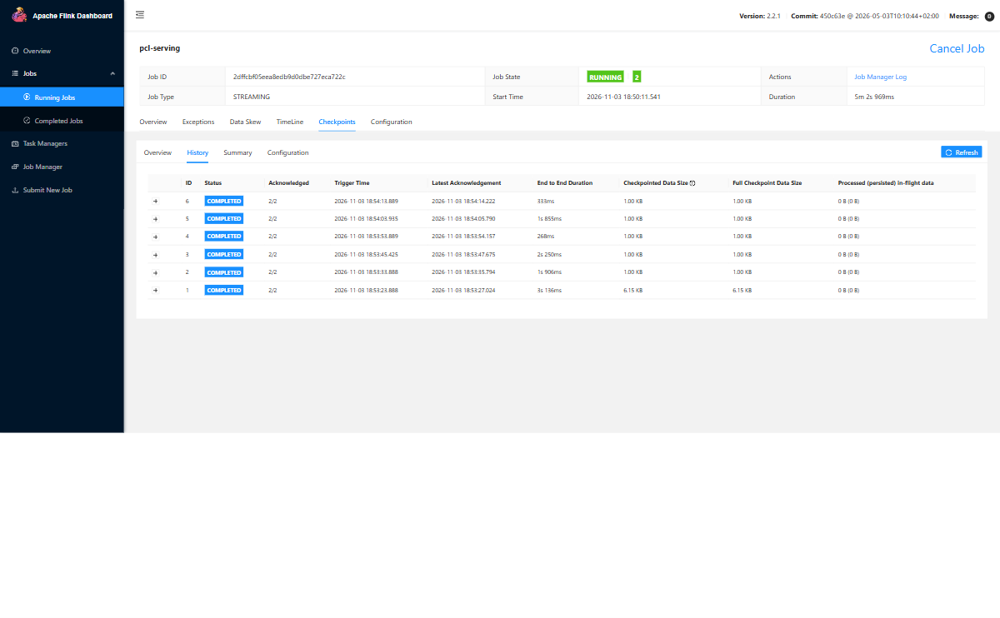
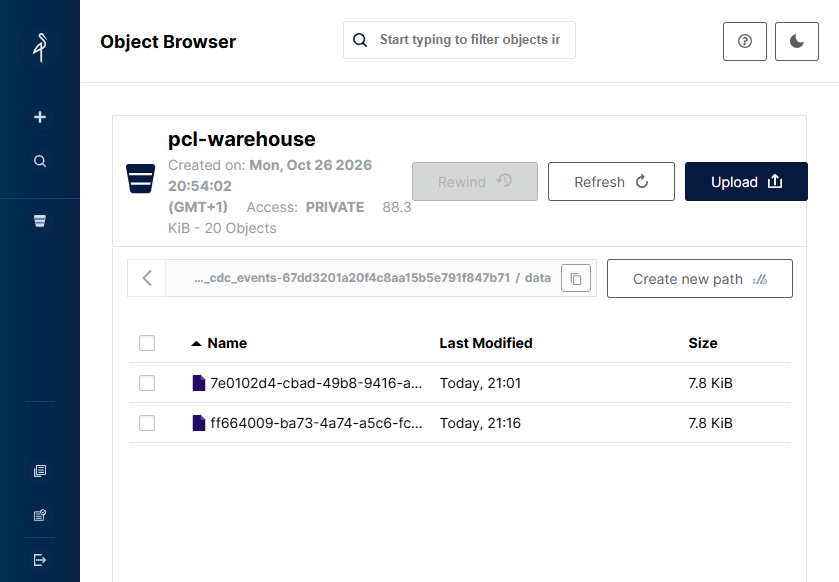
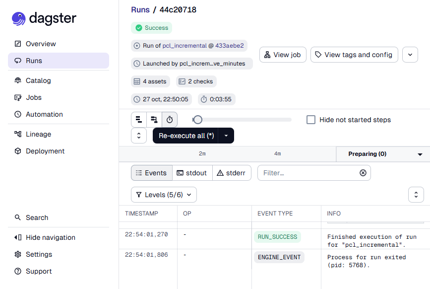
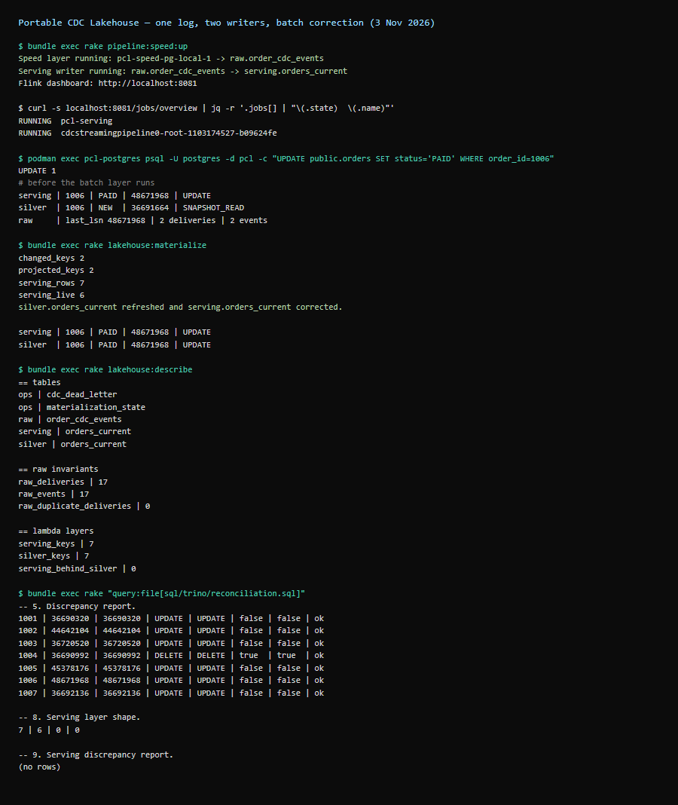

<div align="center">

# 🧊 Portable CDC Lakehouse 🚀

[](https://adoptium.net/)
[](https://beam.apache.org/)
[](https://spark.apache.org/)
[](https://flink.apache.org/)
[](https://iceberg.apache.org/)
[](https://polaris.apache.org/)
[](https://www.postgresql.org/)
[](https://debezium.io/)
[](https://kafka.apache.org/)
[](https://min.io/)
[](https://trino.io/)
[](https://dagster.io/)
[](#-license)

### Open-source data engineering experiment with Apache Beam, Apache Spark, Flink and Iceberg

Portable CDC Lakehouse is a local Proof of Concept (POC) for capturing database changes with a **lambda architecture**: a continuous speed layer, an authoritative batch layer, and a serving layer that merges both.

It uses PostgreSQL, Debezium, Kafka, Scala on the Beam Java SDK, Apache Spark, Apache Flink, Apache Iceberg, Apache Polaris, MinIO, Trino, and Dagster. The same Beam graph runs as a bounded batch read on DirectRunner or FlinkRunner and as an unbounded speed job on Flink. The speed layer owns its consumer group and checkpoints, the batch layer owns canonical history, and Trino queries a serving view that merges both by source position.

> **In one paragraph:** A local POC that captures PostgreSQL CDC events via Debezium into Kafka, processes them with the same Apache Beam graph both as a continuous speed layer (Flink) and a bounded batch layer (DirectRunner/FlinkRunner), lands canonical history in Apache Iceberg on MinIO through Apache Polaris, and serves a unified current-state view through Trino — all orchestrated by Dagster and operated with Podman, Compose, and Rake.

---

[📋 Disclaimer](#-disclaimer) · [🎯 Project goal](#-project-goal) · [⚖️ Why this architecture](#-why-this-architecture) · [✨ Key highlights](#-key-highlights) · [🏗️ Architecture](#-architecture) · [🗂️ Data model and semantics](#-data-model-and-semantics) · [📸 Results](#-results) · [📜 License](#-license)

</div>

---

## ⚠️ Disclaimer

This repository is an open-source engineering experiment intended for learning and architectural exploration. It is a POC, not a production-ready data platform. It does not provide production availability, security hardening, recovery guarantees, performance SLAs, or end-to-end exactly-once delivery.

## 🎯 Project goal

The goal is to make the path from a relational database change to an auditable lakehouse table visible and reproducible. The POC focuses on the boundaries that are easy to get wrong in streaming systems: CDC envelope normalization, source-position ordering, duplicate delivery, delete tombstones, replay, the interaction between Beam runners and Iceberg storage, and the separation between batch transformation and serving.

## ⚖️ Why this architecture

PostgreSQL answers *what is the state now*. This POC also answers *how did it get here, and can I rebuild it*.

| Question | Querying PostgreSQL directly | This POC |
|---|---|---|
| What is the current state? | Yes, simple and fast | Yes, in `silver` |
| What changed, and when? | No, only the live row | Yes, canonical `raw` history with before/after images |
| What happened to deleted rows? | No, they are gone | Yes, versioned tombstones |
| Can I reprocess after a rule or bug fix? | No, the changes are lost | Yes, rebuild `silver` from `raw` |
| Can analytics run without loading the operational database? | No, they compete with the application | Yes, Trino and Iceberg |
| Can several consumers read the same stream? | No, they couple to the database | Yes, one Kafka stream, many readers |
| Can I read the table as of a past snapshot? | No | Yes, Iceberg snapshots |

The point is not to read better: it is to **reconstruct, audit, and analyze without touching the operational system**.

The trade-off is explicit: two processing paths, two consumer groups, a transient speed table, a transient landing buffer, and more moving parts (Kafka, Flink, Spark, Iceberg, Polaris, Trino). The speed layer gives seconds of freshness; the batch layer gives a rebuildable, authoritative history. For a small dataset that only needs the current row, a direct `SELECT` is the better engineering choice.

## ✨ Key highlights

- 🐘 Capture PostgreSQL changes from the WAL with Debezium.
- 📨 Publish CDC events to Kafka and consume them with a Beam graph.
- ⚡ Run a **continuous speed layer** on Flink with its own consumer group, checkpoints and offsets.
- 🗓️ Run an **authoritative batch layer** on a Dagster schedule with a separate consumer group.
- 🔀 Execute the same Beam graph bounded on DirectRunner/FlinkRunner or unbounded on Flink.
- 🧾 Keep canonical CDC history in Iceberg on MinIO, one row per event.
- 🪦 Project the history into one current-state row per order, preserving deletes as versioned tombstones.
- ♻️ Merge repeated deliveries into canonical `raw` by `event_id` before materializing.
- 🧹 Compact the speed layer against canonical `raw` by `event_id`, never by time.
- 🧩 Serve `serving.orders_current`, a query-time merge of batch and speed, through Trino.
- 🔁 Replay raw history into an isolated Iceberg table.
- 📦 Run local dependencies with Podman; operate the POC through Rake commands.

## 🏗️ Architecture

This is a **lambda architecture**: one CDC stream feeds two processors that never depend on each other, and a serving layer decides at query time which version of each row is current. The rule that makes the design work is simple: **only the batch layer writes canonical history**. The speed layer appends a disposable buffer, the batch layer builds the canonical truth from the source stream, and the serving layer merges both without copying either.



Polaris serves the Iceberg catalog and MinIO stores the data files, so every engine resolves the same tables. The diagram omits replay for clarity: `lakehouse:replay` rebuilds an isolated `silver.orders_current_replay_<id>` table from `raw` and never touches the canonical path.

**Vocabulary.** Five terms are used throughout the README:

| Term | Meaning |
|---|---|
| **Event** | One logical row change, identified by `event_id`. |
| **Delivery** | One Kafka record that carries an event. At-least-once transport means the same event can arrive more than once. |
| **Canonical** | The single row in `raw.order_cdc_events` for an `event_id`. Both layers derive the same id for the same change. |
| **Source position** | `(lsn, tx_id, seq_no)`. LSN alone is not a total order: a transaction can change several rows, and snapshot rows can share a position. |
| **Watermark** | The newest arrival time already folded into `silver.orders_current`. |

### 🧱 The three layers

| Layer | Reads | Writes | Owns | If it stops |
|---|---|---|---|---|
| **Speed** | Kafka, group `pcl-speed-<source>` | `speed.order_cdc_events` (append), dead letters | Flink checkpoints and the speed group offsets | Serving loses freshness; history is untouched. |
| **Batch** | Kafka, group `pcl-batch-<source>` | landing, `raw`, `silver`, speed compaction, replay tables | Canonical history, the materialization watermark, the batch group offsets | Serving keeps the last batch plus whatever speed still holds. |
| **Serving** | `silver` + `speed` through an Iceberg view | The view definition, through Trino | The merge rule itself | Queries fail; no stored data changes. |

Both processors run the **same Beam graph**. Layer, consumer group, target table and offset policy are configuration (`PclSettings`), not separate code: batch writes `raw.order_cdc_events_landing` and leaves offsets to Dagster; speed writes `speed.order_cdc_events` and commits offsets through Flink checkpoints.

### 🔁 What happens to one event

1. **Capture.** Debezium reads the PostgreSQL WAL and publishes one Kafka envelope per change to `pcl.public.orders`, with `lsn`, `txId`, `sequence`, and before/after images. Debezium also emits a key-only tombstone after a delete; it carries no payload, so Beam counts it without processing it.
2. **Normalize.** Beam validates the envelope and derives `event_id` deterministically from source, schema, table, LSN, transaction, sequence and primary key. It also keeps `raw_reference = topic:partition:offset`. An invalid envelope is written to `ops.cdc_dead_letter` with a stable reason code instead of being dropped.
3. **Fan out.** The speed job appends every accepted event to `speed.order_cdc_events`, duplicates included, and checkpoints every 10 seconds. The batch job reads exactly the lag Dagster measured and appends those deliveries to the landing buffer.
4. **Deduplicate at ingest.** Spark merges landing into `raw` by `event_id`: it keeps the newest delivery per event, inserts only events it has not seen, and then deletes from landing only the deliveries `raw` already holds. A repeated delivery is absorbed; a new event waits for the next run.
5. **Commit offsets.** Dagster commits the batch group offsets **after** the merge succeeds. A crash before that point re-reads the same records, and the `event_id` merge makes the re-read harmless.
6. **Project.** Spark materializes `silver.orders_current` incrementally. It reads the watermark, selects the keys that arrived since it, re-ranks their full history by source position, applies an idempotent `MERGE`, and advances the watermark. A delete becomes a versioned tombstone (`is_deleted = true`) instead of removing the row.
7. **Compact.** Spark deletes from `speed` every row whose `event_id` is already canonical in `raw`. Because the key is identity and not time, an event the speed job writes during compaction is never removed.
8. **Serve.** Trino evaluates `serving.orders_current` over `silver` and `speed` at query time. Nothing is copied or synchronized.

### ⚖️ How the serving view resolves an order

The view applies four steps, in this order:

1. **Normalize speed rows.** Extract `order_id` from the canonical `primary_key`, and build the same columns the batch view exposes.
2. **Union both layers.** Batch rows carry `layer_rank = 0`; speed rows carry `layer_rank = 1`.
3. **Collapse duplicate events.** Keep one row per `last_event_id`, preferring rank 0. If batch already holds an event, its copy replaces the speed copy.
4. **Pick one row per order.** Order by `last_lsn DESC`, then `last_tx_id` numerically, then `last_seq_no`, then `last_event_id`, all descending, and keep the first.

The consequence is the rule the whole design depends on: **for an order present in both layers, a speed row can only win with a strictly newer source position, and batch wins every exact-event tie.** A delayed batch run therefore cannot regress a key the speed layer already advanced, and a duplicated speed delivery cannot shadow a newer batch row.

Concretely: if `silver` holds order 1003 at LSN 49,882,848 (`SHIPPED`) and `speed` holds the same order at LSN 56,098,232 (`CANCELLED`), the view returns `CANCELLED`. When batch ingests that event, its copy wins the `event_id` collapse and Spark removes the speed row; the query answer does not change.

### ✍️ Who writes what

| Writer | Writes | Never writes |
|---|---|---|
| Beam, batch mode | `raw.order_cdc_events_landing`, `ops.cdc_dead_letter` | `raw`, `silver`, `speed` |
| Beam, speed mode | `speed.order_cdc_events`, `ops.cdc_dead_letter` | `raw`, `silver`, landing |
| Spark | `raw`, `silver`, speed compaction, replay tables, DDL | The serving view |
| Trino | The `serving.orders_current` definition, through `pcl-provisioner` | Any table |
| Dagster | Batch offsets and orchestration | Data files |

The split exists because Iceberg stores a view with a single SQL dialect, and Trino rejects a view written in Spark's dialect. Trino therefore owns the view definition while Spark remains the only writer of tables.

### 🛡️ Why the layers are independent

- **Separate consumer groups.** `pcl-speed-<source>` and `pcl-batch-<source>` advance independently. The speed job never moves the batch position, and a batch run never steals a partition from the speed job.
- **At-least-once with idempotent effects.** Both reads are at-least-once. In speed, a restart can re-append duplicates, which the view deduplicates and compaction removes. In batch, offsets are committed only after the canonical merge, and the merge is keyed on `event_id`, so a retry converges on the same `raw`.
- **Disposable speed, authoritative batch.** Losing `speed.order_cdc_events` costs freshness, never history: `raw` and `silver` are built from the Kafka stream and can be rebuilt. Losing a batch run costs time: the next run re-reads from the last committed offset.
- **No synchronization in serving.** The view reads the latest committed Iceberg snapshots of both tables. There is no third copy to keep consistent, and batch remains authoritative up to its watermark while speed covers the gap after it.
- **Replay is isolated.** `lakehouse:replay` rebuilds a separate table from `raw`; it never touches `silver`, the watermark, or the view.

### ⏱️ Two clocks

The layers run on different triggers, and that is the point: a slow or failed batch run never stops the real-time path, and a speed restart never changes canonical history.



The speed loop is a real unbounded Flink job: the submitter hands the graph to the JobManager and TaskManager, which execute it continuously and checkpoint every 10 seconds. The batch loop is the only writer of canonical `raw` and `silver`; it can lag, fail or be replayed without stopping the speed path.

## 🧰 Technologies and why they were chosen

### 🐘 PostgreSQL — operational source

PostgreSQL represents the application database whose changes need to reach the lakehouse. Its logical WAL gives Debezium a change stream to capture, while the sample `orders` table keeps the POC grounded in normal relational data. The current implementation focuses on one PostgreSQL source and the `orders` entity.

### 🔌 Debezium and Kafka Connect — CDC capture

Debezium reads the PostgreSQL WAL and emits structured change envelopes, including an initial snapshot and subsequent creates, updates, and deletes. This avoids implementing a custom database poller and gives the pipeline source metadata it can use for ordering. Kafka Connect hosts and manages the connector.

### 📨 Apache Kafka — decoupled event transport

Kafka buffers the CDC stream between the source connector and Beam. This lets capture and processing run independently and gives consumers a replayable topic. The local broker uses KRaft, so the single-node POC does not need ZooKeeper. This setup demonstrates the integration path; it is not a highly available Kafka deployment.

### 🧠 Scala and Apache Beam — shared processing graph

The pipeline is written in Scala 2.13 using Beam's Java SDK. Beam provides one graph for reading Kafka, normalizing and validating events, routing invalid input, and writing accepted rows to an Iceberg table. The target is configuration, not code: batch writes to `raw.order_cdc_events_landing`, the speed job writes to `speed.order_cdc_events`. Keeping those transforms in a Beam graph makes runner portability demonstrable. Beam does not publish a separate official Scala SDK, so Scala/JVM serialization and classloading are explicit compatibility concerns in this POC.

### 🏃 DirectRunner and FlinkRunner — local and distributed execution

DirectRunner executes the graph locally and is useful for the bounded batch path. The classic FlinkRunner submits the same JVM graph to the local Flink JobManager; Flink schedules and executes the operators in the TaskManager. The **speed layer runs there continuously**, with checkpointing every 10 seconds and checkpointed Kafka offsets. A separate Beam worker service is not required for this classic JVM runner. The batch path can also run bounded on FlinkRunner; result-by-result equivalence between the two runners is not claimed.

### ⚡ Apache Spark — batch transformation layer

Spark owns every canonical table write: it merges the landing deliveries into `raw` by `event_id`, maintains the batch view `silver`, compacts the speed table against `raw`, and rebuilds replay targets. It runs as a one-shot `spark-sql` container on the Compose network, so the POC needs no long-lived Spark cluster; the image is built once with the Iceberg runtime baked in. The speed layer only appends to its own table; Spark is the only writer of canonical history. The serving view is the one object Spark does not write: Iceberg stores one SQL dialect per view, so Trino defines it.

### 🧊 Apache Iceberg — open table format

Iceberg stores the transient landing buffer, the canonical event history, the speed buffer, the batch view and the serving view. Landing accepts every batch delivery; `raw` keeps one row per event; `speed` is an append-only real-time buffer; `silver` holds one row per order and records deletes as versioned tombstones, so older changes cannot silently restore a deleted order. Beam appends to landing or speed, Spark writes `raw`, `silver` and the compaction, and Trino defines and reads the merged serving view. Iceberg snapshots make committed table changes inspectable.

### 🗄️ MinIO — local S3-compatible object storage

MinIO gives Beam, Spark and Trino a shared S3 API endpoint without requiring a cloud account. Iceberg data files live in its persistent Podman volume. The POC builds a pinned upstream MinIO release locally, so the binary and the image are reproducible and the version does not drift.

### 📚 Apache Polaris — shared Iceberg REST catalog

Beam, Spark and Trino resolve the same Iceberg tables and snapshots through one REST catalog endpoint. Apache Polaris provides that endpoint, and its metadata lives in a dedicated `polaris` database inside the same PostgreSQL instance as the source (schema `polaris_schema`), so catalog state survives container restarts and needs no separate store. Clients authenticate with OAuth2 client credentials and use their own S3 credentials for data files, since MinIO does not provide STS.

### 🔎 Trino — SQL serving layer

Trino is the SQL serving layer: it reads the Iceberg tables and the `serving.orders_current` view through Polaris and answers business queries, snapshot inspection and reconciliation without loading PostgreSQL. The view performs the lambda merge at query time, so a business query sees a speed event without waiting for the next batch run. Trino also owns the view definition: Iceberg records one SQL dialect per view and Trino refuses a Spark-dialect view, so a dedicated `pcl-provisioner` identity writes it while normal queries stay read-only. Running Trino separately from Spark keeps interactive queries away from ingestion and transformation.

### 🗓️ Dagster — scheduled orchestration

Dagster is the entrypoint of the **batch layer only**: every five minutes it runs the same pinned Spark and Beam containers the Rake tasks run, so there is no second implementation. Each run measures the batch consumer-group lag, reads only that many records into landing, merges them into canonical `raw`, commits the batch offsets after the merge, materializes `silver`, compacts speed against `raw`, and creates the serving view if it is missing. When nothing arrived and landing is empty, it skips the batch JVMs instead of rewriting `silver`. Five asset checks gate each run, and run history lives in a `dagster` database in the same PostgreSQL instance. The speed layer is **not** scheduled here: `rake pipeline:speed:up` starts it as a restartable Compose service. Replay stays explicit: `rake dagster:replay[id,from_lsn,to_lsn]`.

### 📦 Podman, Compose, and Rake — reproducible local operations

Podman runs the services and job containers without requiring Docker Engine. Compose describes the pinned services, named data volumes, the optional Flink cluster and the restartable `pipeline-speed` service. Rake provides repeatable commands for startup/readiness, builds, speed-layer lifecycle, replay, queries, and shutdown. Dagster owns the unattended batch path; Rake owns the speed layer and the manual/test path.

### 📌 Pinned versions and validation

| Component | Version | Validation |
|---|---|---|
| Podman / podman-compose | 5.8.2 / 1.5.0 | Local stack started and exercised |
| Build image / JDK | `scala-sbt:eclipse-temurin-21.0.12_8_1.13.0_2.13.18` / Temurin 21.0.12+8 | Build and test gate |
| Scala / sbt | 2.13.18 / 1.13.0 | Compile and tests |
| Apache Beam / DirectRunner | 2.76.0 | Bounded Kafka-to-Iceberg run |
| Beam FlinkRunner / Apache Flink | 2.76.0 (`beam-runners-flink-2.2`) / 2.2.1 | Bounded job completed on Podman JobManager and TaskManager; the speed mode runs the same graph unbounded with checkpointing |
| Apache Spark | 3.5.9 (Scala 2.12, Java 17) | Landing→raw MERGE, silver MERGE, replay |
| Iceberg Spark runtime / AWS bundle | 1.11.0 | Baked into the Spark image, no runtime downloads |
| PostgreSQL / Kafka | 17.2 / 3.9.1 | Source CDC and topic exercised |
| Debezium Connect | 3.2.4.Final | PostgreSQL connector task reached RUNNING |
| Apache Iceberg | 1.11.0 | Beam landing write, Spark merge, Trino read |
| Apache Polaris | 1.8.0 | OAuth2 catalog API, Postgres metastore, MinIO storage |
| Trino | 476 | Serving queries, reconciliation, snapshot inspection |
| Dagster / dagster-postgres | 1.13.27 / 0.29.27 (Python 3.12, SQLAlchemy 2.0.55) | Scheduled runs, idempotent merge, asset checks, Postgres-backed history |
| confluent-kafka (Dagster image) | 2.16.0 | Consumer-group lag measurement and offset commit |
| MinIO | `RELEASE.2025-10-15T17-29-55Z`, built with Go 1.24.8 | Bucket and Iceberg object writes exercised |
| AWS CLI | 2.27.41 | MinIO bucket bootstrap |

The FlinkRunner artifact family matches Flink 2.2.x, and [Beam's compatibility table](https://beam.apache.org/documentation/runners/flink/) lists support for Beam 2.75.0 and later with that runner family. The compatibility evidence above is specific to this local pinned stack; it does not claim production-cluster validation.

## 🗂️ Data model and semantics

| Table | Layer | Purpose | Important behavior |
|---|---|---|---|
| `raw.order_cdc_events_landing` | Batch | Ingest buffer | The batch Beam job appends every delivery here, duplicates included. Spark merges the rows into canonical `raw` and releases the ones `raw` now holds, so the buffer is transient. |
| `raw.order_cdc_events` | Batch | Canonical event history | One row per `event_id`. Stores source, key, operation, source position, before/after images, snapshot flag, `source_timestamp`, `connector_timestamp`, `raw_reference` (`topic:partition:offset`), batch ID, and event ID. |
| `speed.order_cdc_events` | Speed | Real-time buffer | The continuous Flink job appends accepted deliveries with `pcl-speed-*`. It may contain duplicates; the serving view deduplicates by `event_id`. Spark deletes rows whose event is already canonical. |
| `silver.orders_current` | Batch | Authoritative current state | One row per order; latest source position wins; deletes remain as `is_deleted=true` tombstones; `last_operation` and `last_source_timestamp` describe the winning event. |
| `serving.orders_current` | Serving | Query-time lambda merge | Iceberg view over `silver` and `speed`. The highest `(lsn, tx_id, seq_no, event_id)` wins; batch wins ties. Trino reads it. |
| `ops.cdc_dead_letter` | Both | Invalid input inspection | Stores the reason code and payload for invalid Debezium envelopes from either layer. |
| `ops.materialization_state` | Batch | Incremental watermark | One row per target table; `last_ingested_at` is the arrival bound already folded into the batch view. |
| `silver.orders_current_replay_<id>` | Batch | Isolated replay result | A run-scoped target created by `rake lakehouse:replay`; the canonical projection is left untouched. |

Ordering uses LSN, then the numeric transaction id, then the intra-transaction `sequence` ordinal, then the deterministic event id. Event time and arrival time are not used as the sole precedence rule. Snapshot rows are marked distinctly; deterministic event IDs include the primary key because PostgreSQL snapshot rows can share a source position.

The batch Beam job appends every delivery to `raw.order_cdc_events_landing`. Spark merges that buffer into `raw.order_cdc_events` with `MERGE ... ON event_id`, so repeated delivery is absorbed at ingest and canonical `raw` holds one row per event. The merge keeps the newest delivery per event, inserts only unseen events, releases the deliveries that `raw` already holds, and also removes older copies left by earlier runs. Reconciliation asserts the invariant: zero duplicated event ids.

The speed job appends every accepted delivery to `speed.order_cdc_events`. That table is allowed to contain duplicates and is never canonical: the serving view deduplicates by `event_id`, and Spark deletes rows whose `event_id` is already in `raw`. A speed row that is newer than the batch view is visible immediately; once batch catches up, the same event is canonical and the speed copy disappears.

`lakehouse:merge` runs the landing→raw merge. `lakehouse:materialize` runs it first, then the incremental batch projection, then the speed compaction and the serving-view refresh: it uses `ingested_at` (arrival) to find the keys that changed since the last successful run and re-ranks the full history of only those keys. Source order still decides the winner, so a late event cannot overwrite a newer state. The watermark advances after the `MERGE` commits; a failed run is reprocessed, and the `MERGE` is idempotent. A replay is a full rebuild by definition and never touches the watermark or the serving view.

## 🚀 Quick start

From Windows PowerShell, copy `.env.example` to `.env`, set the local PostgreSQL, MinIO, and Polaris passwords, and point `PCL_HOST_WORKSPACE` and `PCL_PODMAN_SOCKET` at this machine (Dagster starts Spark and Beam through the host engine). Start the services and prepare the CDC source:

```powershell
Copy-Item .env.example .env
bundle exec rake infra:up          # starts the stack and the Dagster batch daemon
bundle exec rake lakehouse:init    # raw, landing, speed, silver, serving view and ops
bundle exec rake debezium:register # registers the PostgreSQL connector
bundle exec rake fixtures:scenarios
bundle exec rake pipeline:speed:up # starts Flink + the continuous speed layer
```

`infra:up` starts PostgreSQL first, ensures the `polaris` and `dagster` databases and `polaris_schema` exist, then starts the rest of the stack and finally the Dagster daemon. The one-shot `polaris-setup` container creates the `pcl` catalog idempotently. Polaris listens on `http://localhost:8181/api/catalog`; its health endpoint is `http://localhost:8182/q/health`. The first `lakehouse:init` builds the pinned Spark image locally; later runs reuse it. It creates the tables with Spark and then defines `serving.orders_current` through Trino's `pcl-provisioner` identity; `rake lakehouse:serve` refreshes that definition after a change.

`pipeline:speed:up` builds the pipeline jar, starts the Flink JobManager/TaskManager and the restartable `pipeline-speed` service. The speed job uses `pcl-speed-<source>` and writes to `speed.order_cdc_events`; it keeps running across Dagster runs. Its dashboard is [localhost:8081](http://localhost:8081). Stop it with `bundle exec rake pipeline:speed:down`; checkpoints survive, so a later start resumes from durable state.

The Dagster schedule is already running and performs the batch loop every five minutes. The UI is at [localhost:3000](http://localhost:3000): `rake dagster:run` triggers the same job on demand, and `rake dagster:replay[readme_proof]` runs a replay through Dagster.

Query the serving layer:

```sql
SELECT * FROM serving.orders_current WHERE NOT is_deleted ORDER BY order_id;
```

`bundle exec rake lakehouse:materialize` runs the landing→raw merge, the batch projection, the speed compaction and the serving-view refresh by hand when you want the batch side immediate; `bundle exec rake query:file[sql/trino/reconciliation.sql]` then inspects the result. A speed event appears in the serving view without waiting for the batch run; after the next batch run the same event is canonical and the speed copy is released.

## 📸 Results

The stack runs end to end: PostgreSQL changes reach Kafka, the continuous Flink job serves them within seconds, the batch Beam job lands them in Iceberg, Spark merges one row per event and maintains the batch view, and Trino reads the serving view. The captures below show both layers and the invariants that connect them. Each subsection presents one capability with the output that proves it.

### 1. Apache Polaris owns the catalog

`rake infra:up` starts PostgreSQL first, creates the `polaris` database and schema, bootstraps the `POLARIS` realm, creates the `pcl` catalog, grants the content privilege and catalog setting that drop-with-purge needs, and only then starts Trino. Every step is idempotent:

```text
$ rake infra:up
Created MinIO bucket 'pcl-warehouse'.

All services ready.
  Trino    http://localhost:8080
  Connect  http://localhost:8083
  MinIO    http://localhost:9001
  Polaris  http://localhost:8181/api/catalog
  Polaris health  http://localhost:8182/q/health
  Dagster  http://localhost:3000
```

```text
$ podman logs pcl-polaris-bootstrap
Realm 'POLARIS' successfully bootstrapped.
Bootstrap completed successfully.

$ podman logs pcl-polaris-setup
Requesting a Polaris access token...
Polaris catalog 'pcl' already exists.
Polaris catalog role 'catalog_admin' already holds CATALOG_MANAGE_CONTENT.
Polaris catalog 'pcl' already enables drop-with-purge.
```

The setup is idempotent: a re-run reports that the catalog and its grants already exist.

The realm is stored in PostgreSQL, and the health endpoint reports `UP`:



### 2. Both runners process the same CDC stream

Debezium reports the connector and its single task as `RUNNING`:

```json
{"name":"pcl-postgres-orders","connector":{"state":"RUNNING"},"tasks":[{"id":0,"state":"RUNNING"}],"type":"source"}
```

The bounded DirectRunner pass read 21 Kafka records: 15 valid events, 4 deliberately invalid envelopes that became dead letters, and 2 Kafka tombstones (the key-only delete markers Debezium emits, which carry no payload). It wrote one Iceberg data file:

```text
elements_read=21  accepted_events=15  rejected_events=4  kafka_tombstones=2  dataFilesWritten=1
```

The FlinkRunner pass ran the same graph on the same topic and produced the same 15 accepted events. Repeated passes re-read whatever the consumer group has not committed, but they append to the landing table, not to canonical history. Two bounded passes over the same 21 records left 30 deliveries for 15 distinct events; the merge absorbed the duplicates, left canonical `raw` unchanged at 15 rows, and drained the buffer:

```text
$ rake lakehouse:merge
landing_rows	30
landing_events	15
landing_duplicates	15
raw_rows	15
raw_event_ids	15
landing_remaining	0
```

Canonical `raw` therefore holds one row per event, and the projection reads it without a dedup step.

The same job also runs continuously on Flink, where it accumulates checkpoints:



The checkpoint history shows the externalized checkpoints Flink writes, so a restart resumes from durable state:



### 3. The speed layer is independent and the serving view merges it

`rake pipeline:speed:up` submits the unbounded graph to Flink as a restartable Compose service. It runs with its own consumer group, owns its offsets through checkpoints, and appends only to `speed.order_cdc_events`:

```text
job 46e9f5d7dd7a854c5684cf7907a265a6  RUNNING
checkpoints completed in retained history  117
external checkpoint  file:/opt/flink/checkpoints/<job>/chk-117
consumer group       pcl-speed-pg-local-1   offset 25/25   lag 0
```

While the batch daemon was stopped, one `UPDATE public.orders SET status = 'CANCELLED' WHERE order_id = 1003` reached the speed table within a commit interval. The serving view returned it immediately while the batch view still held the previous status:

```text
serving | 1003 | CANCELLED | 56098232 | UPDATE
silver  | 1003 | SHIPPED   | 49882848 | UPDATE
speed   | 1003 | CANCELLED | 56098232 | UPDATE
```

The batch layer then caught up through its own consumer group. `rake lakehouse:materialize` merged the landing deliveries into canonical `raw`, reprojected the changed key, and compacted the speed rows that `raw` now owns:

```text
landing_rows	19
landing_events	19
landing_duplicates	0
raw_rows	19
raw_event_ids	19
landing_remaining	0
changed_keys	1
speed_rows	0
speed_stale	0
```

The serving view still returns seven keys, now sourced from batch, and `speed.order_cdc_events` is empty: the speed layer was disposable, and no history depended on it. This pass re-read the topic after the earlier runner evidence, so canonical `raw` grew from 15 to 19 distinct events; the merge absorbed the redeliveries.

### 4. Spark materializes through Polaris

`rake lakehouse:init` creates the namespaces and tables with a one-shot `spark-sql` container. `rake lakehouse:materialize` first merges landing into canonical `raw` and then applies the incremental projection `MERGE`. Both talk to the same Polaris REST catalog as Beam and Trino:

```text
$ rake lakehouse:init
$ podman run --rm --network pcl_default ... localhost/pcl-spark:3.5.9-iceberg-1.11.0 \
    /opt/spark/bin/spark-sql --properties-file /opt/pcl/conf/spark-defaults.conf -f /opt/pcl/conf/work/bootstrap_catalog.sql
Spark master: local[*], Application Id: local-1793215973901
Time taken: 10.077 seconds
Time taken: 0.187 seconds
Time taken: 0.235 seconds
Time taken: 6.058 seconds
Time taken: 1.804 seconds
Time taken: 0.303 seconds
Time taken: 0.205 seconds
Time taken: 0.181 seconds
Iceberg tables ready (spark-sql, catalog pcl).
```

The first materialization reads the watermark (epoch) and scans every key; later runs rescan only the keys with new arrivals. Because the `MERGE` is idempotent, a repeated batch converges on the same result, but it is not free: Spark rewrites the files that contain matched rows and commits an overwrite snapshot even when no business value changes. The capture below ran with an empty landing table and still re-ranked the one key sitting exactly on the watermark boundary, which the `>=` detection window re-checks on purpose.

```text
$ rake lakehouse:materialize
$ podman run --rm --network pcl_default ... localhost/pcl-spark:3.5.9-iceberg-1.11.0 \
    /opt/spark/bin/spark-sql --properties-file /opt/pcl/conf/spark-defaults.conf -f /opt/pcl/conf/work/merge_raw.sql
Spark master: local[*], Application Id: local-1793221071539
Time taken: 5.575 seconds
Time taken: 17.84 seconds
Time taken: 0.5 seconds
Time taken: 6.127 seconds
landing_rows	0
landing_events	0
landing_duplicates	0
raw_rows	18
raw_event_ids	18
landing_remaining	0
Raw history merged (spark-sql, catalog pcl).

$ podman run --rm --network pcl_default ... localhost/pcl-spark:3.5.9-iceberg-1.11.0 \
    /opt/spark/bin/spark-sql --properties-file /opt/pcl/conf/spark-defaults.conf -f /opt/pcl/conf/work/materialize_orders.sql
Spark master: local[*], Application Id: local-1793221152831
Time taken: 8.759 seconds
Time taken: 0.318 seconds
Time taken: 0.71 seconds
Time taken: 1.273 seconds
Time taken: 2.111 seconds
changed_keys	1
projected_keys	1
Time taken: 28.228 seconds
Time taken: 6.212 seconds
Current-state projection refreshed (spark-sql, catalog pcl).
```

```text
$ rake lakehouse:describe

== tables
ops | cdc_dead_letter
ops | materialization_state
raw | order_cdc_events
raw | order_cdc_events_landing
silver | orders_current
silver | orders_current_replay_readme_proof
silver | orders_current_replay_window_probe

== current-state snapshots
8420377990516329023 | overwrite | 2026-10-28 21:01:20.125 UTC
6237484225022081417 | overwrite | 2026-10-28 20:53:59.581 UTC
2887277163017433748 | overwrite | 2026-10-28 20:40:59.072 UTC
2342165614340389472 | overwrite | 2026-10-28 20:37:23.509 UTC
4503210802233713410 | overwrite | 2026-10-28 20:17:39.862 UTC
4709231253593627168 | overwrite | 2026-10-27 21:53:30.220 UTC
8028985869781163391 | overwrite | 2026-10-27 21:44:26.723 UTC
4705716679392310919 | overwrite | 2026-10-27 20:15:40.567 UTC
1414936190202702993 | overwrite | 2026-10-27 19:58:06.729 UTC
1580568179560580880 | overwrite | 2026-10-27 19:47:57.356 UTC
319887680504692394 | overwrite | 2026-10-27 19:45:20.538 UTC
6413925175051381393 | append | 2026-10-27 19:36:03.249 UTC

== materialization watermark
silver.orders_current | 2026-10-28 20:50:45.807 UTC | 2026-10-28 21:01:20.942 UTC

== raw invariants
raw_rows | 18
landing_rows | 0
raw_event_ids | 18
```

`lakehouse:describe` reads those tables, snapshots, the watermark and the raw invariants through Trino, the same endpoint any SQL client uses.

Polaris prefixes each table location with a UUID. The raw table's Parquet and metadata files are visible in the MinIO object browser:



### 5. Reconciliation and replay

Reconciliation asserts that canonical `raw` has no duplicate event ids and reports the landing backlog; both are zero. The projection still matches the history key by key:

```text
-- 1. Live vs deleted split of the projection.
false | 6
true  | 1

-- 2. Raw uniqueness invariant. Spark merges landing deliveries by event_id, so
0 | 0

-- 3. Landing backlog. Rows wait here only between the Beam append and the
0 | 0

-- 6. Discrepancy report.
1001 | 39108792 | 39108792 | UPDATE | UPDATE | false | false | ok
1002 | 48907840 | 48907840 | UPDATE | UPDATE | false | false | ok
1003 | 49882848 | 49882848 | UPDATE | UPDATE | false | false | ok
1004 | 31464816 | 31464816 | DELETE | DELETE | true | true | ok
1005 | 31464960 | 31464960 | CREATE | CREATE | false | false | ok
1006 | 31465512 | 31465512 | CREATE | CREATE | false | false | ok
1007 | 47819440 | 47819440 | UPDATE | UPDATE | false | false | ok
```

A full replay into an isolated table reproduces the live projection exactly:

```text
$ $env:PCL_REPLAY_ID='readme_proof'; rake lakehouse:replay
Replay readme_proof materialized to pcl.silver.orders_current_replay_readme_proof: 7 keys, 1 tombstones.
Full replay readme_proof matches silver.orders_current exactly.
```

A bounded replay applies the same logic to an inclusive LSN window, so the target holds only the keys that changed inside it:

```text
$ $env:PCL_REPLAY_ID='window_probe'
$ $env:PCL_REPLAY_FROM_LSN='31464100'; $env:PCL_REPLAY_TO_LSN='31465000'
$ rake lakehouse:replay
Replay window_probe materialized to pcl.silver.orders_current_replay_window_probe: 5 keys, 1 tombstones.
```

```text
SELECT order_id, status, is_deleted, last_lsn
  FROM iceberg.silver.orders_current_replay_window_probe ORDER BY order_id;

1001 | PAID | false | 31464144
1002 | PAID | false | 31464704
1003 | NEW  | false | 31464104
1004 |      | true  | 31464816
1005 | NEW  | false | 31464960
```

Orders 1006 and 1007 are absent because their events fall outside the window. A bounded replay is a partial history by construction, so `lakehouse:replay` reports its shape instead of asserting equality with the live projection.

### 6. Invalid envelopes are quarantined, not dropped

Four deliberately invalid envelopes were published to the same Kafka topic: truncated JSON, an unknown `op`, a delete with no row image, and an update with no primary key. `infra/fixtures/invalid_envelopes.jsonl` holds them, so the check is reproducible:

```powershell
Get-Content infra/fixtures/invalid_envelopes.jsonl |
  podman exec -i pcl-kafka /opt/kafka/bin/kafka-console-producer.sh `
    --bootstrap-server localhost:9092 --topic pcl.public.orders
$env:PCL_MAX_RECORDS = '25'; bundle exec rake pipeline:direct
```

When the four envelopes were first published the topic held 19 records; that bounded pass accepted 13 and rejected 4:

```text
elements_read=19  accepted_events=13  rejected_events=4  kafka_tombstones=2  dataFilesWritten=1
```

Each rejection keeps a stable reason code, the original payload, and the run that observed it:

```text
-- 8. Dead letter overview, by reason code.
INCONSISTENT_PAYLOAD | 1
MALFORMED_JSON       | 1
MISSING_PRIMARY_KEY  | 1
UNKNOWN_OPERATION    | 1

MALFORMED_JSON       | - | {"op":"c","after":
UNKNOWN_OPERATION    | - | {"op":"x","after":{"order_id":9001,"status":"GHOST"}
INCONSISTENT_PAYLOAD | - | {"op":"d","source":{"db":"pcl","schema":"public","ta
MISSING_PRIMARY_KEY  | - | {"op":"u","after":{"status":"NO_KEY"},"source":{"db"
```

`event_id` is empty on purpose: the envelope never reached identity derivation, so there is no canonical id to attach. The payload and the Kafka reference are what make the record diagnosable, and none of the four reached `raw` or `silver`.

### 7. Dagster runs the pipeline unattended

The schedule is created in `RUNNING` state, so `rake infra:up` starts orchestrating without a manual trigger:

```text
$ podman exec pcl-dagster-daemon dagster schedule list -w /opt/dagster/app/workspace.yaml
Repository __repository__
*************************
Schedule: pcl_incremental_every_five_minutes [RUNNING]
Cron Schedule: */5 * * * *
```

Two `UPDATE` statements reached PostgreSQL with no manual trigger; the next tick measured a lag of two records, read them into landing, merged them into canonical `raw`, committed offset 24, and materialized the keys that had arrived since the watermark:

```text
... raw_cdc_events - Reading 2 pending records from pcl.public.orders.
... raw_cdc_events - Committed offsets {0: 24} after the merge.
... raw_cdc_events_batch_fully_accounted - Asset check 'batch_fully_accounted' on 'raw_cdc_events' passed. Description: '2 of 2 records were accepted, quarantined, or delete markers.'
... raw_cdc_events_raw_events_unique - Asset check 'raw_events_unique' on 'raw_cdc_events' passed. Description: '0 event ids appear more than once in raw.'
... orders_current_projection_matches_history - Asset check 'projection_matches_history' on 'orders_current' passed. Description: '0 keys disagree with the history.'
... RUN_SUCCESS - Finished execution of run for "pcl_incremental".
```

The lambda steps and checks also run on an idle tick: the speed table is empty, so compaction is skipped instead of starting a Spark container, and the serving view is reused because it already exists. The two lambda checks still gate the run:

```text
... speed_compaction - Speed layer is empty; skipping compaction.
... serving_orders - Serving view already exists; no refresh needed.
... serving_orders_speed_fully_compacted - Asset check 'speed_fully_compacted' on 'serving_orders' passed. Description: '0 speed rows are already canonical in raw.'
... serving_orders_serving_prefers_batch - Asset check 'serving_prefers_batch' on 'serving_orders' passed. Description: '0 serving keys are older than the batch view.'
```

All five checks passed in the validated run (`batch_fully_accounted`, `raw_events_unique`, `projection_matches_history`, `speed_fully_compacted`, `serving_prefers_batch`).

The metadata the run recorded:

| Asset | Metadata | Value |
|---|---|---|
| `raw_cdc_events` | pending / read / accepted | 2 / 2 / 2 |
| `raw_cdc_events` | rejected / tombstones / data files written | 0 / 0 / 1 |
| `raw_cdc_events` | landing rows / events / duplicates | 2 / 2 / 0 |
| `raw_cdc_events` | raw rows / raw event ids / landing remaining | 18 / 18 / 0 |
| `orders_current` | pending raw events | 2 |
| `orders_current` | changed / projected keys | 3 / 3 |
| `orders_current` | watermark | `2026-10-28 20:50:45.807345 UTC` |
| `orders_current` | projection keys (live / tombstone) | 7 (6 / 1) |

Three keys were re-ranked, not two: the two orders that changed and the key sitting exactly on the previous watermark, which the `>=` detection window re-checks on purpose.

The following tick found nothing new and skipped both JVMs:

```text
... raw_cdc_events - No pending records for pcl.public.orders.
... orders_current - No raw events since the watermark; skipping the MERGE.
... RUN_SUCCESS - Finished execution of run for "pcl_incremental".
```

The run queue serializes ticks (`max_concurrent_runs: 1` in `infra/dagster/dagster.yaml`): a tick that fires while a merge is still running waits for it instead of writing the landing table concurrently.



Replay is not scheduled. `rake dagster:replay` runs the same Spark script through the same container, with an optional inclusive LSN window:

```text
$ rake "dagster:replay[readme_proof]"
... orders_current_replay - Full replay readme_proof matches silver.orders_current exactly.
... RUN_SUCCESS - Finished execution of run for "pcl_replay".
```

### 8. Terminal evidence

A single capture of the commands behind the state above:



### What this shows

- **One source of truth.** Every engine resolves the same Iceberg tables through Polaris, so history, projection and replay cannot drift apart.
- **Idempotent ingest.** Beam lands every delivery, and Spark merges one row per `event_id` into canonical `raw`; repeated delivery never accumulates there, and a uniqueness check fails the run if it ever does.
- **Portable processing.** The same Beam graph runs locally and on Flink, and the transformation is plain SQL that Spark executes.
- **Auditable by construction.** Canonical history keeps one row per event, deletes stay as tombstones, and reconciliation plus a full replay must agree with the live projection.
- **Unattended and guarded.** Dagster runs the graph on a schedule, commits offsets only after a complete read and the canonical merge, and a failed check stops the run.

This is a **proof of concept**, not a production-ready platform. Restart/recovery behavior is exercised at the checkpoint-configuration level, not through a sustained failure-injection campaign. The speed layer is at-least-once: a restart can append duplicates, and the serving view plus the `event_id` compaction absorb them. The canonical landing→raw merge is still a scheduled Spark batch, not a continuously running upsert sink; a production deployment would use an exactly-once Iceberg upsert sink or a dedicated merge service, and would use a catalog with multi-dialect view support instead of provisioning the view from one engine. The batch scheduler is a single cron job with five asset checks: it has no retry policy, backfill UI, or alerting, and its daemon is one process, so scheduled runs have a single point of failure. Performance benchmarking, schema evolution, and a second source table remain unvalidated. Exactly-once processing and production throughput are not claimed.

## 📜 License

This is a Proof of Concept. Not intended for production use.

This project is licensed under the MIT License, an open-source software license that allows developers to freely use, copy, modify, and distribute the software. This includes use in both personal and commercial projects. The only requirement is that the original copyright notice and this permission notice be included in all copies or substantial portions of the Software.

```
MIT License

Copyright (c) 2026 Sergio Sanchez

Permission is hereby granted, free of charge, to any person obtaining a copy
of this software and associated documentation files (the "Software"), to deal
in the Software without restriction, including without limitation the rights
to use, copy, modify, merge, publish, distribute, sublicense, and/or sell
copies of the Software, and to permit persons to whom the Software is
furnished to do so, subject to the following conditions:

The above copyright notice and this permission notice shall be included in all
copies or substantial portions of the Software.

THE SOFTWARE IS PROVIDED "AS IS", WITHOUT WARRANTY OF ANY KIND, EXPRESS OR
IMPLIED, INCLUDING BUT NOT LIMITED TO THE WARRANTIES OF MERCHANTABILITY,
FITNESS FOR A PARTICULAR PURPOSE AND NONINFRINGEMENT. IN NO EVENT SHALL THE
AUTHORS OR COPYRIGHT HOLDERS BE LIABLE FOR ANY CLAIM, DAMAGES OR OTHER
LIABILITY, WHETHER IN AN ACTION OF CONTRACT, TORT OR OTHERWISE, ARISING FROM,
OUT OF OR IN CONNECTION WITH THE SOFTWARE OR THE USE OR OTHER DEALINGS IN THE
SOFTWARE.
```
