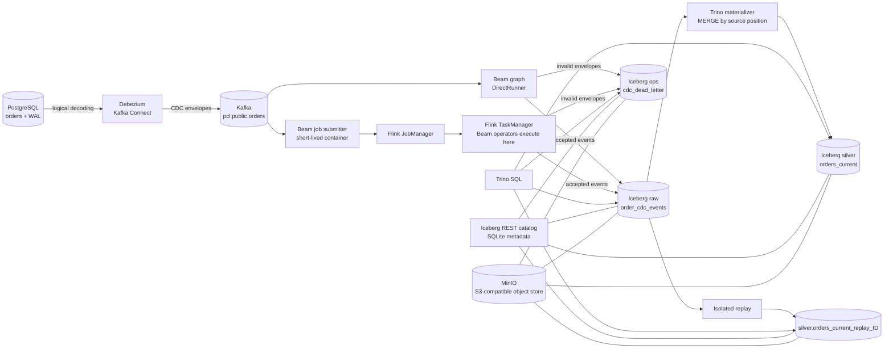
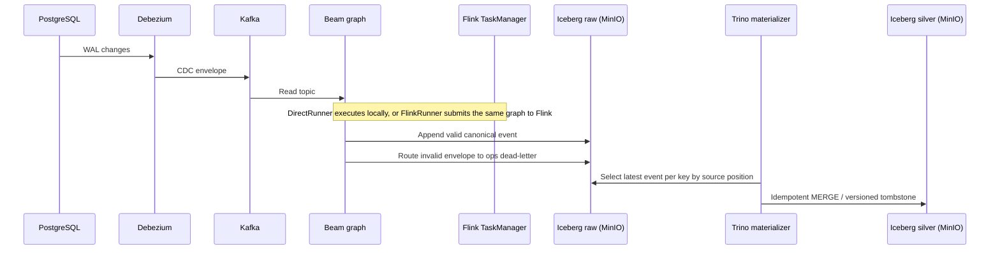

# 🧊 Portable CDC Lakehouse 🚀

### Open-source data engineering experiment with Apache Beam, Flink and Iceberg

Portable CDC Lakehouse is a local Proof of Concept (POC) for capturing database changes, processing them as a stream, and storing both change history and current state in an open table format.

It uses PostgreSQL, Debezium, Kafka, Scala on the Beam Java SDK, Apache Flink, Apache Iceberg, MinIO, and Trino. The same Beam graph has been exercised with DirectRunner and the classic FlinkRunner on separate JobManager and TaskManager containers.

## ⚠️ Disclaimer

This repository is an open-source engineering experiment intended for learning and architectural exploration. It is a POC, not a production-ready data platform. It does not provide production availability, security hardening, recovery guarantees, performance SLAs, or end-to-end exactly-once delivery.

## 🎯 Project goal

The goal is to make the path from a relational database change to an auditable lakehouse table visible and reproducible. The POC focuses on the boundaries that are easy to get wrong in streaming systems: CDC envelope normalization, source-position ordering, duplicate delivery, delete tombstones, replay, and the interaction between Beam runners and Iceberg storage.

## ✨ Key highlights

- 🐘 Capture PostgreSQL changes from the WAL with Debezium.
- 📨 Publish CDC events to Kafka and consume them with a Beam graph.
- 🔀 Run the graph with DirectRunner or submit it to a separate Flink cluster.
- 🧾 Keep append-only CDC history in Iceberg on MinIO.
- 🪦 Materialize one current-state row per order, preserving deletes as versioned tombstones.
- 🔁 Replay raw history into an isolated Iceberg table.
- 🔎 Inspect tables, snapshots, and discrepancies with Trino.
- 📦 Run local dependencies with Podman; operate the POC through Rake commands.

## 🏗️ Architecture



### 🔄 Runtime flow

1. PostgreSQL writes changes to its logical WAL. Debezium reads those changes and publishes envelopes to Kafka.
2. Beam reads the topic, ignores Kafka's null-value delete markers, normalizes Debezium envelopes, and routes valid events to raw history and invalid envelopes to the dead-letter table.
3. With DirectRunner, the Beam process executes locally in its temporary container. With FlinkRunner, that container submits the job; Flink executes the Beam operators in the TaskManager. The submitter is removed after a bounded job finishes, while the Flink services remain available for inspection.
4. Trino runs an idempotent `MERGE` from raw history into `silver.orders_current`, keeping the highest source position per order. Deletes become versioned tombstones.
5. `lakehouse:replay` creates an isolated target table and rebuilds it from all raw events or an inclusive LSN range. It does not update the canonical current-state table.
6. Trino queries inspect the Iceberg tables, snapshots, counts, and reconciliation discrepancies.



## 🧰 Technologies and why they were chosen

### 🐘 PostgreSQL — operational source

PostgreSQL represents the application database whose changes need to reach the lakehouse. Its logical WAL gives Debezium a change stream to capture, while the sample `orders` table keeps the POC grounded in normal relational data. The current implementation focuses on one PostgreSQL source and the `orders` entity.

### 🔌 Debezium and Kafka Connect — CDC capture

Debezium reads the PostgreSQL WAL and emits structured change envelopes, including an initial snapshot and subsequent creates, updates, and deletes. This avoids implementing a custom database poller and gives the pipeline source metadata it can use for ordering. Kafka Connect hosts and manages the connector.

### 📨 Apache Kafka — decoupled event transport

Kafka buffers the CDC stream between the source connector and Beam. This lets capture and processing run independently and gives consumers a replayable topic. The local broker uses KRaft, so the single-node POC does not need ZooKeeper. This setup demonstrates the integration path; it is not a highly available Kafka deployment.

### 🧠 Scala and Apache Beam — shared processing graph

The pipeline is written in Scala 2.13 using Beam's Java SDK. Beam provides one graph for reading Kafka, normalizing and validating events, routing invalid input, and writing Iceberg rows. Keeping those transforms in a Beam graph makes runner portability demonstrable. Beam does not publish a separate official Scala SDK, so Scala/JVM serialization and classloading are explicit compatibility concerns in this POC.

### 🏃 DirectRunner and FlinkRunner — local and distributed execution

DirectRunner is useful for a quick local bounded run and functional checks. The classic FlinkRunner submits the same JVM graph to the local Flink JobManager; Flink schedules and executes the operators in the TaskManager. This makes the distributed runtime visible in Podman while keeping the business transforms shared. A separate Beam worker service is not required for this classic JVM runner. Both modes have completed bounded runs, though an isolated result-by-result equivalence comparison is still open.

### 🧊 Apache Iceberg — open table format

Iceberg stores both the append-only event history and the current-state projection. The raw table preserves the sequence of accepted changes for inspection and replay. The silver table holds one row per order and records deletes as versioned tombstones so older changes cannot silently restore a deleted order. Iceberg snapshots make committed table changes inspectable.

### 🪣 MinIO — local S3-compatible object storage

MinIO gives Beam and Trino a shared S3 API endpoint without requiring a cloud account. Iceberg data files live in its persistent Podman volume. The POC builds a pinned upstream MinIO release locally because the upstream community container image is no longer published; this is documented as an implementation constraint.

### 📚 Iceberg REST catalog with SQLite — shared table metadata

Beam and Trino need to resolve the same Iceberg tables and snapshots. The REST catalog fixture provides that shared catalog endpoint, and its SQLite database is persisted in a Podman volume. SQLite and the fixture image keep the local demo self-contained; this catalog setup is not intended as a production metadata service.

### 🔎 Trino — SQL materialization and inspection

Trino queries Iceberg tables and runs the `MERGE` that materializes the latest source-positioned event per order. Keeping current-state materialization in a separate SQL step isolates it from runner-specific streaming behavior and provides a simple way to inspect the resulting state, snapshots, and discrepancies.

### 📦 Podman, Compose, and Rake — reproducible local operations

Podman runs the services and job containers without requiring Docker Engine. Compose describes the pinned services, named data volumes, and optional Flink cluster. Rake provides repeatable commands for startup/readiness, builds, pipeline submission, replay, queries, and shutdown. These tasks orchestrate the workflow; they are not additional runtime services.

### 📌 Pinned versions and validation

| Component | Version | Validation |
|---|---|---|
| Podman / podman-compose | 5.8.2 / 1.5.0 | Local stack started and exercised |
| Build image / JDK | `scala-sbt:eclipse-temurin-21.0.12_8_1.13.0_2.13.18` / Temurin 21.0.12+8 | Build and test gate |
| Scala / sbt | 2.13.18 / 1.13.0 | Compile and tests |
| Apache Beam / DirectRunner | 2.76.0 | Bounded Kafka-to-Iceberg run |
| Beam FlinkRunner / Apache Flink | 2.76.0 (`beam-runners-flink-2.2`) / 2.2.1 | Bounded job completed on Podman JobManager and TaskManager |
| PostgreSQL / Kafka | 17.2 / 3.9.1 | Source CDC and topic exercised |
| Debezium Connect | 3.2.4.Final | PostgreSQL connector task reached RUNNING |
| Apache Iceberg / Iceberg REST fixture | 1.11.0 / 1.10.1 | Beam write, Trino read, REST catalog shared |
| Trino | 476 | Table creation, materialization, and SQL inspection |
| MinIO | `RELEASE.2025-10-15T17-29-55Z`, built with Go 1.24.8 | Bucket and Iceberg object writes exercised |
| AWS CLI | 2.27.41 | MinIO bucket bootstrap |

The FlinkRunner artifact family matches Flink 2.2.x, and [Beam's compatibility table](https://beam.apache.org/documentation/runners/flink/) lists support for Beam 2.75.0 and later with that runner family. The compatibility evidence above is specific to this local pinned stack; it does not claim production-cluster validation.

## 🗂️ Data model and semantics

| Table | Purpose | Important behavior |
|---|---|---|
| `raw.order_cdc_events` | Canonical append-only history | Stores source, key, operation, source position, before/after images, snapshot flag, batch ID, and event ID. |
| `silver.orders_current` | Current state for each order | One row per order; latest source position wins; deletes remain as `is_deleted=true` tombstones. |
| `ops.cdc_dead_letter` | Invalid input inspection | Stores the reason code and payload for invalid Debezium envelopes. |
| `silver.orders_current_replay_<id>` | Isolated replay result | A run-scoped target created by `rake lakehouse:replay`; the canonical projection is left untouched. |

Ordering uses LSN and transaction/sequence tie-breakers where available. Event time and arrival time are not used as the sole precedence rule. Snapshot rows are marked distinctly; deterministic event IDs include the primary key because PostgreSQL snapshot rows can share a source position.

## 🚀 Quick start

From Windows PowerShell, copy `.env.example` to `.env` and set the local PostgreSQL and MinIO passwords. Start the services and prepare the CDC source:

```powershell
Copy-Item .env.example .env
# Set the local PostgreSQL and MinIO passwords in .env.
bundle exec rake infra:up
bundle exec rake lakehouse:init
bundle exec rake debezium:register
bundle exec rake fixtures:scenarios
```

Launch the unbounded Beam job. It keeps reading CDC events from Kafka and writing them to Iceberg until you stop the Flink cluster:

```powershell
$env:PCL_MAX_RECORDS = '0'
bundle exec rake pipeline:flink
```

This command stays attached while the job runs. Open the Flink dashboard at [localhost:8081](http://localhost:8081). To stop the job from a second PowerShell window, run `bundle exec rake pipeline:flink:stop`.

The `silver.orders_current` projection is refreshed separately; in a second window, run `bundle exec rake lakehouse:materialize` when you want to update it, then inspect it with `bundle exec rake query:file[sql/reconciliation.sql]`.

## 📸 Results from the running POC

Evidence captured from the active Podman cluster on **24 October 2026**:

```text
$ bundle exec rake infra:status
8 containers running: PostgreSQL, Kafka, MinIO, Iceberg REST, Trino,
Kafka Connect, Flink JobManager, and Flink TaskManager

$ Flink REST: GET /jobs/d0aaab107904874e180ef56c5c452cb7
state=FINISHED  duration=91.9s  tasks=8/8 finished  failed=0

$ bundle exec rake lakehouse:materialize
Current-state projection refreshed (query 20261024_130008_00003_22msk).

$ bundle exec rake query:file[sql/reconciliation.sql]
current state: 6 active orders, 1 delete tombstone
per-key reconciliation: 7 keys, all position/key checks = ok
raw history: 52 rows, 13 distinct event IDs (append-only; repeated fixture runs)
dead-letter rows: 0

$ PCL_REPLAY_ID=readme_proof bundle exec rake lakehouse:replay
7 keys, 1 tombstone (query 20261024_130215_00011_22msk)
```

The captured distributed Beam run consumed 15 Kafka records, accepted 13 CDC events, observed 2 Kafka tombstones, and wrote one Iceberg snapshot. That evidence run was bounded and finished; the Quick start above uses the unbounded mode. Replay materialized into its own table, leaving the canonical projection untouched.

## 🔎 What this evidence proves

- PostgreSQL CDC events travel through Debezium and Kafka into Beam, and the FlinkRunner job completes on the local Flink cluster.
- Trino can materialize and inspect Iceberg current state; deletes are represented as tombstones.
- The reconciliation report checks expected key presence and source-position agreement. The replay output above checks key and tombstone counts; neither result compares every business column.
- Raw history is append-only, so repeated fixture runs explain the 52 rows for 13 distinct event IDs.

This is a **proof of concept**, not a production-ready platform. Restart/recovery behavior, full business-value replay comparison, invalid-message integration checks, and performance benchmarking remain unvalidated. Exactly-once processing and production throughput are not claimed.

## 📜 License

See [LICENSE](LICENSE).
