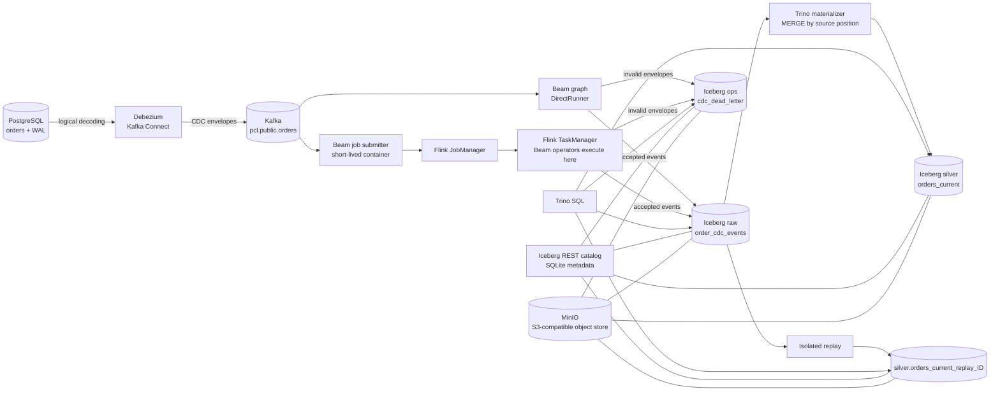
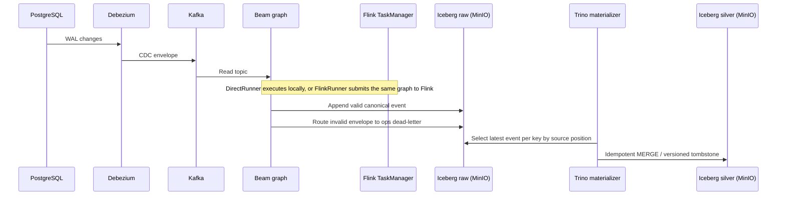

# 🧊 Portable CDC Lakehouse 🚀

### Open-source data engineering experiment with Apache Beam, Flink and Iceberg

Portable CDC Lakehouse is a local Proof of Concept (POC) for capturing database changes, processing them as a stream, and storing both change history and current state in an open table format.

It uses PostgreSQL, Debezium, Kafka, Scala on the Beam Java SDK, Apache Flink, Apache Iceberg, MinIO, and Trino. The same Beam graph has been exercised with DirectRunner and the classic FlinkRunner on separate JobManager and TaskManager containers.

## ⚠️ Disclaimer

This repository is an open-source engineering experiment intended for learning and architectural exploration. It is a POC, not a production-ready data platform. It does not provide production availability, security hardening, recovery guarantees, performance SLAs, or end-to-end exactly-once delivery.

## 🎯 Project goal

The goal is to make the path from a relational database change to an auditable lakehouse table visible and reproducible. The POC focuses on the boundaries that are easy to get wrong in streaming systems: CDC envelope normalization, source-position ordering, duplicate delivery, delete tombstones, replay, and the interaction between Beam runners and Iceberg storage.

## ✨ Key highlights

- 🐘 Capture PostgreSQL changes from the WAL with Debezium.
- 📨 Publish CDC events to Kafka and consume them with a Beam graph.
- 🔀 Run the graph with DirectRunner or submit it to a separate Flink cluster.
- 🧾 Keep append-only CDC history in Iceberg on MinIO.
- 🪦 Materialize one current-state row per order, preserving deletes as versioned tombstones.
- 🔁 Replay raw history into an isolated Iceberg table.
- 🔎 Inspect tables, snapshots, and discrepancies with Trino.
- 📦 Run local dependencies with Podman; operate the POC through Rake commands.

## 🏗️ Architecture



### 🔄 Runtime flow

1. PostgreSQL writes changes to its logical WAL. Debezium reads those changes and publishes envelopes to Kafka.
2. Beam reads the topic, ignores Kafka's null-value delete markers, normalizes Debezium envelopes, and routes valid events to raw history and invalid envelopes to the dead-letter table.
3. With DirectRunner, the Beam process executes locally in its temporary container. With FlinkRunner, that container submits the job; Flink executes the Beam operators in the TaskManager. The submitter is removed after a bounded job finishes, while the Flink services remain available for inspection.
4. Trino runs an idempotent `MERGE` from raw history into `silver.orders_current`, keeping the highest source position per order. Deletes become versioned tombstones.
5. `lakehouse:replay` creates an isolated target table and rebuilds it from all raw events or an inclusive LSN range. It does not update the canonical current-state table.
6. Trino queries inspect the Iceberg tables, snapshots, counts, and reconciliation discrepancies.



## 🧰 Technologies and why they were chosen

### 🐘 PostgreSQL — operational source

PostgreSQL represents the application database whose changes need to reach the lakehouse. Its logical WAL gives Debezium a change stream to capture, while the sample `orders` table keeps the POC grounded in normal relational data. The current implementation focuses on one PostgreSQL source and the `orders` entity.

### 🔌 Debezium and Kafka Connect — CDC capture

Debezium reads the PostgreSQL WAL and emits structured change envelopes, including an initial snapshot and subsequent creates, updates, and deletes. This avoids implementing a custom database poller and gives the pipeline source metadata it can use for ordering. Kafka Connect hosts and manages the connector.

### 📨 Apache Kafka — decoupled event transport

Kafka buffers the CDC stream between the source connector and Beam. This lets capture and processing run independently and gives consumers a replayable topic. The local broker uses KRaft, so the single-node POC does not need ZooKeeper. This setup demonstrates the integration path; it is not a highly available Kafka deployment.

### 🧠 Scala and Apache Beam — shared processing graph

The pipeline is written in Scala 2.13 using Beam's Java SDK. Beam provides one graph for reading Kafka, normalizing and validating events, routing invalid input, and writing Iceberg rows. Keeping those transforms in a Beam graph makes runner portability demonstrable. Beam does not publish a separate official Scala SDK, so Scala/JVM serialization and classloading are explicit compatibility concerns in this POC.

### 🏃 DirectRunner and FlinkRunner — local and distributed execution

DirectRunner is useful for a quick local bounded run and functional checks. The classic FlinkRunner submits the same JVM graph to the local Flink JobManager; Flink schedules and executes the operators in the TaskManager. This makes the distributed runtime visible in Podman while keeping the business transforms shared. A separate Beam worker service is not required for this classic JVM runner. Both modes have completed bounded runs, though an isolated result-by-result equivalence comparison is still open.

### 🧊 Apache Iceberg — open table format

Iceberg stores both the append-only event history and the current-state projection. The raw table preserves the sequence of accepted changes for inspection and replay. The silver table holds one row per order and records deletes as versioned tombstones so older changes cannot silently restore a deleted order. Iceberg snapshots make committed table changes inspectable.

### 🪣 MinIO — local S3-compatible object storage

MinIO gives Beam and Trino a shared S3 API endpoint without requiring a cloud account. Iceberg data files live in its persistent Podman volume. The POC builds a pinned upstream MinIO release locally because the upstream community container image is no longer published; this is documented as an implementation constraint.

### 📚 Iceberg REST catalog with SQLite — shared table metadata

Beam and Trino need to resolve the same Iceberg tables and snapshots. The REST catalog fixture provides that shared catalog endpoint, and its SQLite database is persisted in a Podman volume. SQLite and the fixture image keep the local demo self-contained; this catalog setup is not intended as a production metadata service.

### 🔎 Trino — SQL materialization and inspection

Trino queries Iceberg tables and runs the `MERGE` that materializes the latest source-positioned event per order. Keeping current-state materialization in a separate SQL step isolates it from runner-specific streaming behavior and provides a simple way to inspect the resulting state, snapshots, and discrepancies.

### 📦 Podman, Compose, and Rake — reproducible local operations

Podman runs the services and job containers without requiring Docker Engine. Compose describes the pinned services, named data volumes, and optional Flink cluster. Rake provides repeatable commands for startup/readiness, builds, pipeline submission, replay, queries, and shutdown. These tasks orchestrate the workflow; they are not additional runtime services.

### 📌 Pinned versions and validation

| Component | Version | Validation |
|---|---|---|
| Podman / podman-compose | 5.8.2 / 1.5.0 | Local stack started and exercised |
| Build image / JDK | `scala-sbt:eclipse-temurin-21.0.12_8_1.13.0_2.13.18` / Temurin 21.0.12+8 | Build and test gate |
| Scala / sbt | 2.13.18 / 1.13.0 | Compile and tests |
| Apache Beam / DirectRunner | 2.76.0 | Bounded Kafka-to-Iceberg run |
| Beam FlinkRunner / Apache Flink | 2.76.0 (`beam-runners-flink-2.2`) / 2.2.1 | Bounded job completed on Podman JobManager and TaskManager |
| PostgreSQL / Kafka | 17.2 / 3.9.1 | Source CDC and topic exercised |
| Debezium Connect | 3.2.4.Final | PostgreSQL connector task reached RUNNING |
| Apache Iceberg / Iceberg REST fixture | 1.11.0 / 1.10.1 | Beam write, Trino read, REST catalog shared |
| Trino | 476 | Table creation, materialization, and SQL inspection |
| MinIO | `RELEASE.2025-10-15T17-29-55Z`, built with Go 1.24.8 | Bucket and Iceberg object writes exercised |
| AWS CLI | 2.27.41 | MinIO bucket bootstrap |

The FlinkRunner artifact family matches Flink 2.2.x, and [Beam's compatibility table](https://beam.apache.org/documentation/runners/flink/) lists support for Beam 2.75.0 and later with that runner family. The compatibility evidence above is specific to this local pinned stack; it does not claim production-cluster validation.

## 🗂️ Data model and semantics

| Table | Purpose | Important behavior |
|---|---|---|
| `raw.order_cdc_events` | Canonical append-only history | Stores source, key, operation, source position, before/after images, snapshot flag, batch ID, and event ID. |
| `silver.orders_current` | Current state for each order | One row per order; latest source position wins; deletes remain as `is_deleted=true` tombstones. |
| `ops.cdc_dead_letter` | Invalid input inspection | Stores the reason code and payload for invalid Debezium envelopes. |
| `silver.orders_current_replay_<id>` | Isolated replay result | A run-scoped target created by `rake lakehouse:replay`; the canonical projection is left untouched. |

Ordering uses LSN and transaction/sequence tie-breakers where available. Event time and arrival time are not used as the sole precedence rule. Snapshot rows are marked distinctly; deterministic event IDs include the primary key because PostgreSQL snapshot rows can share a source position.

## 🚀 Quick start

The commands below are for Windows PowerShell from the repository root. This README contains setup, replay, and operational instructions.

```powershell
Copy-Item .env.example .env
# Edit .env and set local Postgres and MinIO passwords.

bundle exec rake infra:up
bundle exec rake lakehouse:init
bundle exec rake debezium:register
bundle exec rake debezium:status
bundle exec rake fixtures:scenarios
```

Run the same bounded Kafka fixture with either runner. Use a clean stack or record the history baseline if comparing outputs, because each capture appends to raw history.

```powershell
$env:PCL_MAX_RECORDS = '20'
bundle exec rake pipeline:direct
Remove-Item Env:PCL_MAX_RECORDS

$env:PCL_MAX_RECORDS = '20'
bundle exec rake pipeline:flink
Remove-Item Env:PCL_MAX_RECORDS
```

`pipeline:flink` starts `pcl-flink-jobmanager` and `pcl-flink-taskmanager` and keeps them running after the bounded submission. The Flink dashboard defaults to [http://localhost:8081](http://localhost:8081). The submitter container is temporary; Beam operators execute in the TaskManager.

```powershell
bundle exec rake lakehouse:materialize
bundle exec rake lakehouse:describe
bundle exec rake query:file[sql/reconciliation.sql]
```

Replay into an isolated table (LSN bounds are optional and inclusive):

```powershell
$env:PCL_REPLAY_ID = 'audit1'
$env:PCL_REPLAY_FROM_LSN = '0'
$env:PCL_REPLAY_TO_LSN = '999999999'
bundle exec rake lakehouse:replay
Remove-Item Env:PCL_REPLAY_ID
Remove-Item Env:PCL_REPLAY_FROM_LSN
Remove-Item Env:PCL_REPLAY_TO_LSN
```

Omit both bounds for a full-history reconstruction. A bounded replay writes only events in that LSN interval into a fresh table; it does not represent the complete state at the end of the interval unless that interval includes the required baseline/snapshot events for every key.

Stop services while preserving their volumes; the Flink services are stopped with the stack. `infra:reset` deletes all stack volumes and is destructive.

```powershell
bundle exec rake infra:status
bundle exec rake infra:logs[flink-taskmanager]
bundle exec rake infra:down
```

Use `bundle exec rake -T` to list the operational tasks. Build and local checks are available through `bundle exec rake verify`; CI/CD is intentionally out of scope.

## 📊 Observability and evidence

- Beam emits a JSON startup record with `run_id`, source, topic, and status, then reports available Beam counters such as accepted events, rejected events, Kafka tombstones, and Iceberg writer/snapshot counts.
- `rake lakehouse:describe` lists tables and current-state Iceberg snapshots.
- `rake query:file[sql/reconciliation.sql]` reports operation counts, duplicate event IDs, dead-letter reasons, and per-key discrepancies.
- A bounded DirectRunner Kafka-to-Iceberg capture completed and was read back through Trino.
- A bounded classic FlinkRunner job completed in the separate Podman cluster. The recorded run read 15 Kafka records, accepted 13 CDC events, observed 2 tombstones, and wrote one Iceberg snapshot.
- `rake verify` passed with 54 unit and architecture tests. It does not replace the outstanding integration and recovery scenarios listed below.

## 🧪 POC validation status

The POC demonstrates the main CDC-to-lakehouse path, but it is **not a complete production validation**. The current evidence and remaining experimental work are summarized here.

| Area | Status | Evidence / remaining work |
|---|---|---|
| CDC capture | Demonstrated | PostgreSQL → Debezium → Kafka fixture exercised. |
| Canonical contract and validation | Unit-tested; integration pending | Normalization/validation is unit-tested and the Beam graph routes invalid envelopes to DLQ; an invalid input still needs an end-to-end assertion. |
| DirectRunner and FlinkRunner | Both execute; comparison pending | Bounded jobs completed on both. Compare their logical outputs using isolated, identical fixture baselines. |
| Current-state upsert and delete | Demonstrated for `orders` | Newer source positions win; deletes persist as tombstones; reconciliation inspects the projection. |
| Idempotency and duplicates | Partial | Domain and materializer idempotency are implemented; duplicate delivery is not yet an automated end-to-end scenario, and raw remains append-only. |
| Replay reconstruction | Implemented; result check pending | Isolated full/LSN-range replay exists. Compare replay keys, business values, and tombstones with an expected reference. |
| Recovery after restart | Not validated | Checkpoint/offset and failure-window restart behavior have not been tested. |
| Iceberg and Podman operations | Demonstrated | Trino inspects tables and snapshots; Rake commands cover start/status/logs/stop/reset. |
| Observability and performance | Partial | Available counters and SQL reports cover part of the pipeline. Complete duplicate/obsolete/commit counters and record a synthetic throughput/duration measurement. |

### 🔭 Remaining experimental work

1. Add deterministic duplicate and out-of-order fixture scenarios; prove snapshot-versus-WAL precedence on an isolated dataset.
2. Add an integration check that injects an invalid Debezium envelope and asserts its reason and payload in `ops.cdc_dead_letter`.
3. Compare DirectRunner and FlinkRunner outputs against the same fixture baseline, then reconcile both.
4. Reconcile a replay target by keys, business values, and tombstones; associate the replay ID with the result evidence.
5. Exercise restart/failure windows and define checkpoint/offset behavior. The POC does not claim end-to-end exactly-once.
6. Complete observability for duplicate, obsolete, commit, and discrepancy counters; current logs/counters and SQL reports cover only part of the pipeline.
7. Record a documented synthetic-load duration/throughput measurement. No production SLA is implied.

CI/CD, production cloud deployment, HA, Kubernetes, and a production SLA are outside this experiment's scope.

## ⚖️ Strengths and trade-offs

| Strength | Trade-off / boundary |
|---|---|
| Raw history, current state, and replay have separate responsibilities. | Raw is append-only and can contain repeated deliveries; logical projection correctness does not deduplicate the history table. |
| Both local and distributed Beam runners use the same application graph. | Compatibility is proven only for this pinned local Podman stack and bounded capture. |
| MinIO, Iceberg REST, Iceberg tables, and Trino run locally. | MinIO is built from a pinned upstream source release; the REST catalog is a POC fixture backed by SQLite. |
| Source positions and delete tombstones protect state ordering. | Recovery/checkpoint semantics and exactly-once behavior across Kafka, Beam, and Iceberg are not claimed. |
| Rake offers repeatable manual operations without CI/CD. | Local resource usage and throughput have not been benchmarked as production characteristics. |

## 🗺️ Repository map

```text
compose.yaml                         Podman services and the optional Flink profile
src/main/scala/.../domain            Pure CDC contract and state rules
src/main/scala/.../adapters          Debezium decoding and normalization
src/main/scala/.../app               Beam pipeline composition and IcebergIO
sql/bootstrap_catalog.sql            Iceberg raw, silver, and ops schemas
sql/materialize_orders.sql           Idempotent current-state MERGE
sql/reconciliation.sql               Counts, tombstones, and discrepancy report
infra/fixtures/                      Deterministic PostgreSQL CDC mutations
rakelib/                             Build, infrastructure, pipeline, replay, and query tasks
```

## 📜 License

See [LICENSE](LICENSE).
