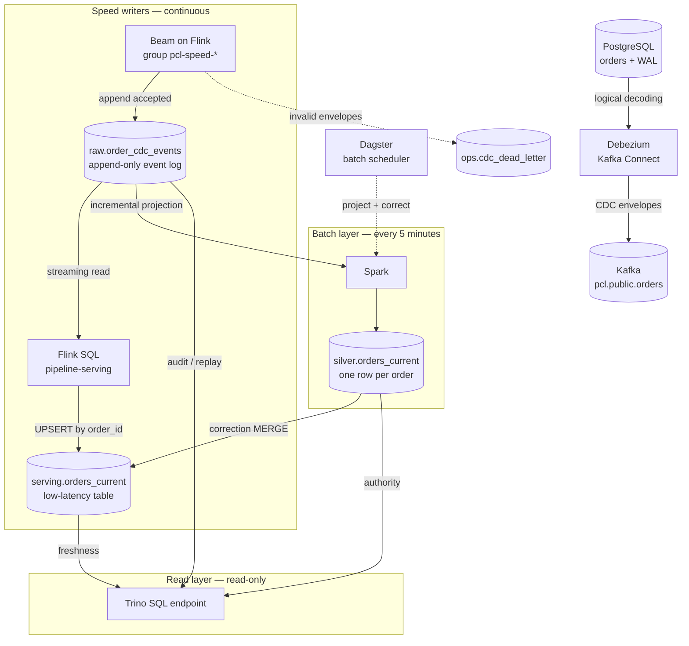
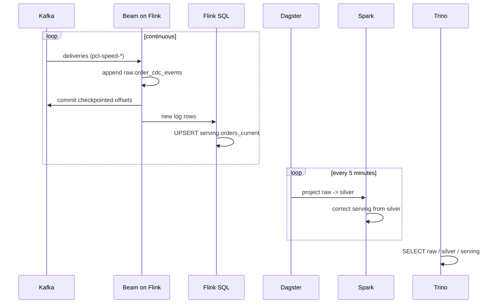

<div align="center">

# 🧊 Portable CDC Lakehouse: A Reproducible Lambda Architecture for PostgreSQL CDC

[](https://adoptium.net/)
[](https://beam.apache.org/)
[](https://spark.apache.org/)
[](https://flink.apache.org/)
[](https://iceberg.apache.org/)
[](https://polaris.apache.org/)
[](https://www.postgresql.org/)
[](https://debezium.io/)
[](https://kafka.apache.org/)
[](https://min.io/)
[](https://trino.io/)
[](https://dagster.io/)
[](#-license)

### One append-only Iceberg event log, a Flink SQL serving layer, a Spark authoritative batch layer, and read-only Trino — all on Podman

Portable CDC Lakehouse is a local Proof of Concept for turning PostgreSQL changes into an auditable lakehouse with a **lambda architecture**: an append-only event log written by Flink, a serving table kept fresh in seconds, an authoritative batch layer that owns the current state, and a Trino endpoint that only reads committed tables.

> **In one paragraph:** Debezium captures the PostgreSQL WAL into Kafka. A Beam-on-Flink job normalizes every change and appends it to `raw.order_cdc_events`, an append-only log that is never updated or deleted. A second Flink SQL job reads that log as a stream and UPSERTs `serving.orders_current` by `order_id`. Every five minutes Dagster runs Spark to project the log into `silver.orders_current` and overwrite serving rows whose canonical position is newer or equal. Trino reads `serving` for freshness and `silver`/`raw` for authority and audit — it never merges at query time.

---

[📋 Disclaimer](#-disclaimer) · [🎯 Project goal](#-project-goal) · [⚖️ Why this architecture](#-why-this-architecture) · [✨ Key highlights](#-key-highlights) · [🏗️ Architecture](#-architecture) · [🗂️ Data model and semantics](#-data-model-and-semantics) · [📸 Results](#-results) · [📜 License](#-license)

</div>

---

## ⚠️ Disclaimer

This repository is an open-source engineering experiment intended for learning and architectural exploration. It is a POC, not a production-ready data platform. It does not provide production availability, security hardening, recovery guarantees, performance SLAs, retention, or end-to-end exactly-once delivery.

## 🎯 Project goal

The goal is to make the path from a relational database change to an auditable lakehouse table visible and reproducible. The POC focuses on the boundaries that are easy to get wrong in streaming systems: CDC envelope normalization, source-position ordering, duplicate delivery, delete tombstones, replay, the split between a low-latency serving projection and an authoritative current state, and the interaction between Flink, Spark, Iceberg, and a REST catalog.

## ⚖️ Why this architecture

PostgreSQL answers *what is the state now*. This POC also answers *how did it get here, and can I rebuild it*.

| Question | Querying PostgreSQL directly | This POC |
|---|---|---|
| What is the current state? | Yes, simple and fast | Yes, in `serving` within seconds, and in `silver` authoritatively |
| What changed, and when? | No, only the live row | Yes, in the append-only `raw` log with before/after images |
| What happened to deleted rows? | No, they are gone | Yes, versioned tombstones |
| Can I reprocess after a rule or bug fix? | No, the changes are lost | Yes, rebuild `silver` from `raw` |
| Can analytics run without loading the operational database? | No, they compete with the application | Yes, Trino and Iceberg |
| Can several consumers read the same stream? | No, they couple to the database | Yes, one Kafka stream, two independent readers |
| Can I read the table as of a past snapshot? | No | Yes, Iceberg snapshots |

The trade-off is explicit: two continuous Flink writers, a five-minute Spark projection, an unbounded event log, and more moving parts (Kafka, Flink, Spark, Iceberg, Polaris, Trino). The speed layer gives seconds of freshness; the batch layer gives a rebuildable, authoritative current state. For a small dataset that only needs the current row, a direct `SELECT` is the better engineering choice.

## ✨ Key highlights

- 🐘 Capture PostgreSQL changes from the WAL with Debezium.
- 📨 Publish CDC events to Kafka and normalize them once with a Beam graph.
- ⚡ Keep an **append-only event log** in `raw.order_cdc_events` on Flink.
- 🚀 **UPSERT `serving.orders_current` from Flink** so Trino sees a change in seconds.
- 🗓️ Run an **authoritative batch layer** on a Dagster schedule with Spark.
- 🧾 Keep the audit trail in `raw`, with before/after images and source positions.
- 🪦 Project the log into `silver`, one current row per order, with tombstones.
- 🩹 **Correct serving from silver** whenever the batch position is newer or equal.
- 🔁 Replay the log into an isolated Iceberg table.
- 🔒 Give Trino read-only access: no views, no writes, no query-time merge.
- 📦 Run local dependencies with Podman; operate the POC through Rake.

## 🏗️ Architecture

This is a **lambda architecture with one immutable event log**. The rule that makes the design work is simple: **Flink appends the log and serves the low-latency projection, Spark owns the authoritative current state, and Trino only reads.** Serving is allowed to be temporarily ahead of batch; it is never allowed to stay behind it.



Polaris serves the Iceberg catalog and MinIO stores the data files, so every engine resolves the same tables. The diagram omits replay for clarity: `lakehouse:replay` rebuilds an isolated `silver.orders_current_replay_<id>` table from the log and never touches the canonical path.

**Vocabulary.**

| Term | Meaning |
|---|---|
| **Event** | One logical row change, identified by `event_id`. |
| **Delivery** | One Kafka record that carries an event. At-least-once transport means the same event can arrive more than once. |
| **Raw log** | `raw.order_cdc_events`: the immutable, append-only history of deliveries. |
| **Source position** | `(lsn, tx_id, seq_no)`. LSN alone is not a total order: a transaction can change several rows, and snapshot rows can share a position. |
| **Correction** | Overwriting a serving row when the canonical `silver` position is newer or equal. |
| **Watermark** | The newest arrival time already folded into `silver.orders_current`. |

### 🧱 The layers

| Layer | Reads | Writes | Owns | If it stops |
|---|---|---|---|---|
| **Speed writer** | Kafka, group `pcl-speed-<source>` | `raw.order_cdc_events` (append), dead letters | Flink checkpoints and the speed group offsets | Serving stops advancing; batch still projects from the log. |
| **Serving writer** | `raw.order_cdc_events` in streaming | `serving.orders_current` (UPSERT) | The low-latency projection | Serving stops advancing; batch still corrects it. |
| **Batch** | `raw.order_cdc_events` | `silver`, serving correction, replay tables | The authoritative projection and the watermark | Serving keeps the last batch plus whatever Flink still wrote. |
| **Read** | `raw`, `silver`, `serving` | Nothing | Nothing | Queries fail; no stored data changes. |

The two Flink jobs are continuous and independent of Dagster. The batch graph is incremental: it projects only the keys touched since the watermark and corrects only the serving keys that disagree with `silver`.

**Why the log is append-only.** Iceberg's Flink streaming reader follows *append* snapshots. If the batch layer updated or deleted rows in `raw`, the reader would hit a non-append snapshot and fail. Keeping `raw` immutable removes that conflict by construction, and it is also the honest shape of a lambda log: the speed writer appends, the batch layer reads.

### 🔁 What happens to one event

1. **Capture.** Debezium reads the PostgreSQL WAL and publishes one Kafka envelope per change to `pcl.public.orders`, with `lsn`, `txId`, `sequence`, and before/after images. Debezium also emits a key-only tombstone after a delete; it carries no payload, so Beam counts it without processing it.
2. **Normalize.** Beam validates the envelope and derives `event_id` deterministically from source, schema, table, LSN, transaction, sequence and primary key. It also keeps `raw_reference = topic:partition:offset`. An invalid envelope is written to `ops.cdc_dead_letter` with a stable reason code instead of being dropped.
3. **Append the log.** The speed job appends every accepted event to `raw.order_cdc_events`, duplicates included, and checkpoints every 10 seconds. Nothing updates or deletes a row.
4. **Serve in seconds.** `pipeline-serving` reads the log as a Flink streaming source and UPSERTs `serving.orders_current` by `order_id`. A new event is visible to Trino without waiting for Dagster.
5. **Project.** Spark materializes `silver.orders_current` incrementally. It reads the watermark, selects the keys that arrived since it, re-ranks their full history by source position, deduplicates deliveries by `event_id`, applies an idempotent `MERGE`, and advances the watermark. A delete becomes a versioned tombstone (`is_deleted = true`) instead of removing the row.
6. **Correct serving.** Spark compares `serving` with `silver` and overwrites a serving row only when the batch position is newer or equal. A speed event that already advanced a key is never rolled back by a delayed batch run.
7. **Read.** Trino evaluates a plain `SELECT` over the materialized tables. It does not merge layers, define views, or write anything.

### 🩹 How serving is corrected

The correction MERGE uses the strongest available order:

```text
last_lsn > serving.last_lsn
OR (last_lsn = serving.last_lsn AND batch.tx_id > serving.tx_id)
OR (last_lsn = serving.last_lsn AND batch.tx_id = serving.tx_id AND batch.seq_no > serving.seq_no)
OR (equal position AND batch.last_event_id >= serving.last_event_id)
```

The last clause is the tie-breaker that lets batch win an exact-event tie. The consequences are:

- A speed row that is **newer** than batch stays visible and is never regressed by a delayed batch run.
- A row the speed writer projected **incorrectly** is replaced by the canonical version as soon as batch reaches the same position or later.
- Re-running the correction at the same position changes nothing; the MERGE is idempotent.

### ✍️ Who writes what

| Writer | Writes | Never writes |
|---|---|---|
| Beam speed job | `raw.order_cdc_events` (append), `ops.cdc_dead_letter` | `silver`, `serving` |
| Flink SQL serving job | `serving.orders_current` (UPSERT) | `raw`, `silver` |
| Spark | `silver`, serving correction, replay tables, DDL | `raw` |
| Dagster | Orchestration and metadata | Data files |
| Trino | Nothing | Any table, view, schema, or catalog object |

### 🛡️ Why the layers are independent

- **One log, two readers.** The Beam job owns `pcl-speed-<source>` and its checkpoints; the serving job follows the log; Spark reconciles on a schedule. None of them shares a consumer group with another.
- **At-least-once with idempotent effects.** A Flink restart can re-append a delivery. In the log, duplicates are expected; the projection deduplicates by `event_id`. In `serving`, the upsert key is `order_id` and the correction MERGE is position-aware.
- **Append-only by construction.** No step rewrites or deletes the log, so the Flink streaming reader never encounters a non-append snapshot.
- **Rebuildable.** Losing `raw` costs a Kafka replay, not history; there is no second copy to keep in sync.
- **No query-time merge.** Trino reads committed Iceberg snapshots. There is no third copy to keep consistent and no engine-specific view dialect to maintain.
- **Replay is isolated.** `lakehouse:replay` rebuilds a separate table from the log; it never touches `silver`, the watermark, or `serving`.

### ⏱️ Two clocks



The speed loop is a real unbounded Flink job: the submitter hands the graph to the JobManager and TaskManager, which execute it continuously and checkpoint every 10 seconds. The serving writer is a second Flink job on the same cluster. The batch loop is the only writer of `silver` and the serving correction; it can lag, fail, or be replayed without stopping the speed path.

## 🧰 Technologies and why they were chosen

### 🐘 PostgreSQL — operational source

PostgreSQL represents the application database whose changes need to reach the lakehouse. Its logical WAL gives Debezium a change stream to capture, while the sample `orders` table keeps the POC grounded in normal relational data.

### 🔌 Debezium and Kafka Connect — CDC capture

Debezium reads the PostgreSQL WAL and emits structured change envelopes, including an initial snapshot and subsequent creates, updates, and deletes. Kafka Connect hosts and manages the connector. This avoids implementing a custom database poller.

### 📨 Apache Kafka — decoupled event transport

Kafka buffers the CDC stream between the source connector and the processors. This lets capture and processing run independently and gives consumers a replayable topic. The local broker uses KRaft, so the single-node POC needs no ZooKeeper.

### 🧠 Scala and Apache Beam — the normalization graph

The speed pipeline is written in Scala 2.13 using Beam's Java SDK. Beam provides one graph for reading Kafka, normalizing and validating events, routing invalid input, and appending accepted rows to the Iceberg log. The bounded DirectRunner mode remains available as a portability test and writes to the same log, but it is not part of the scheduled path. Beam does not publish a separate official Scala SDK, so Scala/JVM serialization and classloading are explicit compatibility concerns in this POC.

### ⚡ Apache Flink — speed and serving writers

Flink runs two long-lived jobs. The Beam graph on FlinkRunner appends normalized events to the log with checkpointed Kafka offsets. A Flink SQL job reads that log in streaming mode and UPSERTs `serving.orders_current` with the Iceberg Flink connector. The Flink image bakes in the Iceberg 1.12 Flink 2.2 runtime and the AWS bundle, so the SQL job never resolves dependencies at runtime.

### 🗓️ Apache Spark — authoritative batch transformation

Spark owns the batch tables: it projects the log into an incremental `silver`, corrects `serving` by source position, and rebuilds replay targets. It runs as a one-shot `spark-sql` container on the Compose network, so the POC needs no long-lived Spark cluster; the image is built once with the Iceberg runtime baked in.

### 🧊 Apache Iceberg — open table format

Iceberg stores the append-only event log, the batch projection and the serving table. `raw` only grows; `silver` holds one row per order and records deletes as versioned tombstones; `serving` is an upsert table keyed by `order_id`. Iceberg snapshots make committed table changes inspectable.

### 🗄️ MinIO — local S3-compatible object storage

MinIO gives Beam, Flink, Spark and Trino a shared S3 API endpoint without requiring a cloud account. Iceberg data files live in its persistent Podman volume. The POC builds a pinned upstream MinIO release locally, so the binary and the image are reproducible.

### 📚 Apache Polaris — shared Iceberg REST catalog

All engines resolve the same Iceberg tables and snapshots through one REST catalog endpoint. Apache Polaris provides that endpoint, and its metadata lives in a dedicated `polaris` database inside the same PostgreSQL instance as the source (schema `polaris_schema`), so catalog state survives container restarts. Clients authenticate with OAuth2 client credentials and use their own S3 credentials for data files, since MinIO does not provide STS.

### 🔎 Trino — read-only SQL endpoint

Trino reads the materialized Iceberg tables through Polaris and answers business queries, snapshot inspection and reconciliation without loading PostgreSQL. It is deliberately read-only: the file-based access control allows `read-only` on the catalog and nothing else, and the architecture gives Trino no table or view to own. Freshness queries read `serving`; authoritative queries read `silver`; audit queries read `raw`.

### 🗓️ Dagster — scheduled orchestration

Dagster is the entrypoint of the **batch layer only**: every five minutes it runs the same pinned Spark container the Rake tasks run, so there is no second implementation. Each run projects the log into `silver` incrementally and corrects `serving`, skipping the JVMs when there is nothing to do. Two asset checks gate each run, and run history lives in a `dagster` database in the same PostgreSQL instance. The speed and serving writers are **not** scheduled here: `rake pipeline:speed:up` starts them as Compose services. Replay stays explicit: `rake dagster:replay[id,from_lsn,to_lsn]`.

### 📦 Podman, Compose, and Rake — reproducible local operations

Podman runs the services and job containers without requiring Docker Engine. Compose describes the pinned services, named data volumes, the optional Flink cluster and the two speed writers. Rake provides repeatable commands for startup/readiness, builds, speed-layer lifecycle, replay, queries, and shutdown. Dagster owns the unattended batch path; Rake owns the speed layer and the manual/test path.

### 📌 Pinned versions and validation

| Component | Version | Validation |
|---|---|---|
| Podman / podman-compose | 5.8.2 / 1.5.0 | Local stack started and exercised |
| Build image / JDK | `scala-sbt:eclipse-temurin-21.0.12_8_1.13.0_2.13.18` / Temurin 21.0.12+8 | Build and test gate |
| Scala / sbt | 2.13.18 / 1.13.0 | Compile and tests |
| Apache Beam / DirectRunner | 2.76.0 | Bounded Kafka-to-Iceberg portability run |
| Beam FlinkRunner / Apache Flink | 2.76.0 (`beam-runners-flink-2.2`) / 2.2.1 | Continuous speed job with checkpointing |
| Apache Spark | 3.5.9 (Scala 2.12, Java 17) | Log→silver projection, serving correction, replay |
| Iceberg Spark runtime / AWS bundle | 1.11.0 | Baked into the Spark image, no runtime downloads |
| Flink runtime / Iceberg Flink runtime / AWS bundle | 2.2.1 / 1.12.0 / 1.12.0 | Baked into the Flink image for the SQL serving writer |
| PostgreSQL / Kafka | 17.2 / 3.9.1 | Source CDC and topic exercised |
| Debezium Connect | 3.2.4.Final | PostgreSQL connector task reached RUNNING |
| Apache Iceberg | 1.11.0 (Spark/Beam) / 1.12.0 (Flink) | Table writes and reads through Polaris |
| Apache Polaris | 1.8.0 | OAuth2 catalog API, Postgres metastore, MinIO storage |
| Trino | 476 | Read-only serving queries, reconciliation, snapshot inspection |
| Dagster / dagster-postgres | 1.13.27 / 0.29.27 (Python 3.12, SQLAlchemy 2.0.55) | Scheduled runs, idempotent batch, asset checks, Postgres-backed history |
| MinIO | `RELEASE.2025-10-15T17-29-55Z`, built with Go 1.24.8 | Bucket and Iceberg object writes exercised |
| AWS CLI | 2.27.41 | MinIO bucket bootstrap |

The FlinkRunner artifact family matches Flink 2.2.x, and [Beam's compatibility table](https://beam.apache.org/documentation/runners/flink/) lists support for Beam 2.75.0 and later with that runner family. Iceberg 1.12 is the first release with a Flink 2.2 runtime. The compatibility evidence above is specific to this local pinned stack; it does not claim production-cluster validation.

## 🗂️ Data model and semantics

| Table | Layer | Purpose | Important behavior |
|---|---|---|---|
| `raw.order_cdc_events` | Speed / Batch | Append-only event log | The Beam speed job appends accepted deliveries with `pcl-speed-*` and checkpoints offsets. It may contain duplicate deliveries after a restart; nothing updates or deletes it. Spark deduplicates by `event_id` when projecting, and Trino reads it for audit. |
| `serving.orders_current` | Serving | Low-latency current state | Flink UPSERTs one row per `order_id` through the `upsert-enabled` sink option and the table's identifier field. Spark overwrites a row when canonical `silver` is at the same or a newer position. Trino reads it. |
| `silver.orders_current` | Batch | Authoritative current state | One row per order; latest source position wins; deletes remain as `is_deleted=true` tombstones; `last_operation` and `last_source_timestamp` describe the winning event. |
| `ops.cdc_dead_letter` | Speed | Invalid input inspection | Stores the reason code and payload for invalid Debezium envelopes. |
| `ops.materialization_state` | Batch | Incremental watermark | One row per target table; `last_ingested_at` is the arrival bound already folded into `silver`. |
| `silver.orders_current_replay_<id>` | Batch | Isolated replay result | A run-scoped target created by `rake lakehouse:replay`; the canonical projection is left untouched. |

Ordering uses LSN, then the numeric transaction id, then the intra-transaction `sequence` ordinal, then the deterministic event id. Event time and arrival time are not used as the sole precedence rule. Snapshot rows are marked distinctly; deterministic event IDs include the primary key because PostgreSQL snapshot rows can share a source position.

The log is at-least-once: the same `event_id` can appear more than once if the Flink speed job replays a checkpoint. That is expected and harmless. `projection_source.sql` keeps the newest delivery per `event_id` before ranking, so `silver` is one row per order. The serving writer trusts delivery order and does not rank; the batch correction is what guarantees that `serving` eventually matches `silver`.

`lakehouse:materialize` runs the incremental projection and the serving correction. It uses `ingested_at` (arrival) to find the keys that changed since the last successful run and re-ranks the full history of only those keys. Source order still decides the winner, so a late event cannot overwrite a newer state. The watermark advances after the `MERGE` commits; a failed run is reprocessed, and the `MERGE` is idempotent. A replay is a full rebuild by definition and never touches the watermark or `serving`.

There is no compaction step. Removing rows from `raw` would create a non-append snapshot and stop the Flink streaming reader; retention is deliberately out of scope for this POC.

## 🚀 Quick start

From Windows PowerShell, copy `.env.example` to `.env`, set the local PostgreSQL, MinIO, and Polaris passwords, and point `PCL_HOST_WORKSPACE` and `PCL_PODMAN_SOCKET` at this machine (Dagster starts Spark through the host engine). Start the services and prepare the CDC source:

```powershell
Copy-Item .env.example .env
bundle exec rake infra:up          # starts the stack and the Dagster batch daemon
bundle exec rake lakehouse:init    # raw, silver, serving and ops
bundle exec rake debezium:register # registers the PostgreSQL connector
bundle exec rake fixtures:scenarios
bundle exec rake pipeline:speed:up # Flink cluster + Beam speed + Flink SQL serving
```

`infra:up` starts PostgreSQL first, ensures the `polaris` and `dagster` databases and `polaris_schema` exist, then starts the rest of the stack and finally the Dagster daemon. The one-shot `polaris-setup` container creates the `pcl` catalog idempotently. Polaris listens on `http://localhost:8181/api/catalog`; its health endpoint is `http://localhost:8182/q/health`. The first `lakehouse:init` builds the pinned Spark image locally; later runs reuse it.

`pipeline:speed:up` builds the Beam jar and the Iceberg-enabled Flink image, starts the Flink JobManager/TaskManager, submits the Beam speed job, and submits the Flink SQL serving job. The speed job uses `pcl-speed-<source>` and appends to `raw.order_cdc_events`; the serving job reads that log and upserts `serving.orders_current`. Both keep running across Dagster runs. The dashboard is [localhost:8081](http://localhost:8081). Stop them with `bundle exec rake pipeline:speed:down`; checkpoints survive, so a later start resumes from durable state.

The Dagster schedule is already running and performs the batch loop every five minutes. The UI is at [localhost:3000](http://localhost:3000): `rake dagster:run` triggers the same job on demand, and `rake dagster:replay[readme_proof]` runs a replay through Dagster.

Query the serving layer:

```sql
SELECT * FROM serving.orders_current WHERE NOT is_deleted ORDER BY order_id;
```

`bundle exec rake lakehouse:materialize` runs the batch projection and the serving correction by hand when you want the batch side immediate; `bundle exec rake query:file[sql/trino/reconciliation.sql]` then inspects the result. A new event appears in `serving` without waiting for Dagster; after the next batch run the same event is authoritative in `silver`, and the correction leaves serving at the same or a newer position.

## 📸 Results

The stack runs the full path: PostgreSQL changes reach Kafka, the Flink speed job appends them to the log, the Flink SQL job serves them from `serving`, and the Dagster/Spark batch layer builds `silver` and corrects serving. The captures below show the components and the invariants that connect them. The fixture set has seven orders; exact delivery counts depend on how many times the topic was re-read before the consumer group committed.

### 1. Apache Polaris owns the catalog

`rake infra:up` starts PostgreSQL first, creates the `polaris` database and schema, bootstraps the `POLARIS` realm, creates the `pcl` catalog, grants the content privilege and catalog setting that drop-with-purge needs, and only then starts Trino. Every step is idempotent:

```text
$ rake infra:up
Created MinIO bucket 'pcl-warehouse'.

All services ready.
  Trino    http://localhost:8080
  Connect  http://localhost:8083
  MinIO    http://localhost:9001
  Polaris  http://localhost:8181/api/catalog
  Polaris health  http://localhost:8182/q/health
  Dagster  http://localhost:3000
  Speed layer  rake pipeline:speed:up  (Flink, continuous)
```

```text
$ podman logs pcl-polaris-bootstrap
Realm 'POLARIS' successfully bootstrapped.
Bootstrap completed successfully.

$ podman logs pcl-polaris-setup
Requesting a Polaris access token...
Polaris catalog 'pcl' already exists.
Polaris catalog role 'catalog_admin' already holds CATALOG_MANAGE_CONTENT.
Polaris catalog 'pcl' already enables drop-with-purge.
```

The realm is stored in PostgreSQL, and the health endpoint reports `UP`:


### 2. Flink runs the speed and serving writers

`rake pipeline:speed:up` starts two long-lived jobs on the session cluster:

```text
$ curl -s localhost:8081/jobs/overview | jq -r '.jobs[] | "\(.state)  \(.name)"'
RUNNING  pcl-serving
RUNNING  cdcstreamingpipeline0-root-1103174527-b09624fe
```

The Beam job owns the `pcl-speed-<source>` group and its checkpoints. The SQL job owns no Kafka group: it follows the append-only log and upserts `serving.orders_current` by `order_id`.


The checkpoint history shows the externalized checkpoints Flink writes, so a restart resumes from durable state:


### 3. Serving is fresh without Trino merging

While the batch daemon was stopped, a status change on `order_id = 1006` reached the log and the Flink SQL writer upserted it immediately: `serving` shows `PAID @ 48671968` while `silver` still holds the older `NEW @ 36691664`. Trino read the materialized tables:

```text
serving | 1006 | PAID   | 48671968 | UPDATE
silver  | 1006 | NEW    | 36691664 | UPDATE
raw     | 1006 | PAID   | 48671968 | UPDATE
```

The freshness came from the serving table, not from a query-time union: `serving.orders_current` is a real Iceberg table with `order_id` as its identifier field, the Flink `upsert-enabled` sink option, and merge-on-read writes.

The batch layer then caught up through its own path. `rake lakehouse:materialize` projected the changed keys into `silver` and corrected serving:

```text
raw_deliveries     17
raw_events         17
raw_duplicate_deliveries 0
changed_keys       2
projected_keys     2
serving_rows       7
serving_live       6
```

After the correction, `serving` and `silver` agree at LSN 48671968. The log keeps the event; it was never compacted or rewritten.

### 4. Spark materializes through Polaris

`rake lakehouse:init` creates the namespaces and tables with a one-shot `spark-sql` container. The bootstrap also sets `order_id` as the serving identifier field and enables merge-on-read upserts, which is what makes the Flink SQL sink an upsert instead of an append:

```text
$ rake lakehouse:init
$ podman run --rm --network pcl_default ... localhost/pcl-spark:3.5.9-iceberg-1.11.0 \
    /opt/spark/bin/spark-sql --properties-file /opt/pcl/conf/spark-defaults.conf -f /opt/pcl/conf/work/bootstrap_catalog.sql
Spark master: local[*], Application Id: local-1793215973901
Time taken: 10.077 seconds
Time taken: 0.187 seconds
Time taken: 0.235 seconds
Time taken: 6.058 seconds
Time taken: 1.804 seconds
Time taken: 0.303 seconds
Time taken: 0.205 seconds
Time taken: 0.181 seconds
Iceberg tables are ready (raw, silver, serving, ops).
```

The first materialization reads the watermark (epoch) and scans every key; later runs rescan only the keys with new arrivals. Because the `MERGE` is idempotent, a repeated batch converges on the same result.

`lakehouse:describe` reads the tables, snapshots, the watermark and the layer invariants through Trino, the same endpoint any SQL client uses:

```text
$ rake lakehouse:describe

== tables
ops | cdc_dead_letter
ops | materialization_state
raw | order_cdc_events
serving | orders_current
silver | orders_current

== current-state snapshots
7131151487439035446 | overwrite | 2026-11-03 19:14:32.296 UTC
4896094255512414457 | overwrite | 2026-11-03 18:27:46.634 UTC
2841251897447469863 | overwrite | 2026-11-02 15:01:59.715 UTC
2364954906478816631 | append | 2026-11-02 14:25:24.939 UTC

== materialization watermark
silver.orders_current | 2026-11-03 18:53:53.461 UTC | 2026-11-03 19:14:33.152 UTC

== raw invariants
raw_deliveries | 17
raw_events | 17
raw_duplicate_deliveries | 0

== lambda layers
silver_keys | 7
serving_keys | 7
serving_behind_silver | 0
```

Polaris prefixes each table location with a UUID. The raw table's Parquet and metadata files are visible in the MinIO object browser:


### 5. Reconciliation and replay

Reconciliation reports the log's delivery shape, checks that the projection agrees with the history, and checks that serving is never behind `silver`:

```text
-- 2. Event log shape.
17 | 17 | 0

-- 5. Discrepancy report.
1001 | 36690320 | 36690320 | UPDATE | UPDATE | false | false | ok
1002 | 44642104 | 44642104 | UPDATE | UPDATE | false | false | ok
1003 | 36720520 | 36720520 | UPDATE | UPDATE | false | false | ok
1004 | 36690992 | 36690992 | DELETE | DELETE | true | true | ok
1005 | 45378176 | 45378176 | UPDATE | UPDATE | false | false | ok
1006 | 48671968 | 48671968 | UPDATE | UPDATE | false | false | ok
1007 | 36692136 | 36692136 | UPDATE | UPDATE | false | false | ok

-- 8. Serving layer shape.
7 | 6 | 0 | 0

-- 9. Serving discrepancy report.
(no rows)
```

A full replay into an isolated table reproduces the live projection exactly:

```text
$ $env:PCL_REPLAY_ID='readme_proof'; rake lakehouse:replay
Replay readme_proof materialized to pcl.silver.orders_current_replay_readme_proof: 7 keys, 1 tombstones.
Full replay readme_proof matches silver.orders_current exactly.
```

A bounded replay applies the same logic to an inclusive LSN window, so the target holds only the keys that changed inside it:

```text
$ $env:PCL_REPLAY_ID='window_probe'
$ $env:PCL_REPLAY_FROM_LSN='45378176'; $env:PCL_REPLAY_TO_LSN='48671968'
$ rake lakehouse:replay
Replay window_probe materialized to pcl.silver.orders_current_replay_window_probe: 2 keys, 0 tombstones.
```

Orders 1005 and 1006 fall inside the window; 1001–1004 and 1007 are absent because their events fall outside it. A bounded replay is a partial history by construction, so `lakehouse:replay` reports its shape instead of asserting equality with the live projection.

### 6. Invalid envelopes are quarantined, not dropped

Four deliberately invalid envelopes were published to the same Kafka topic: truncated JSON, an unknown `op`, a delete with no row image, and an update with no primary key. `infra/fixtures/invalid_envelopes.jsonl` holds them, so the check is reproducible:

```powershell
Get-Content infra/fixtures/invalid_envelopes.jsonl |
  podman exec -i pcl-kafka /opt/kafka/bin/kafka-console-producer.sh `
    --bootstrap-server localhost:9092 --topic pcl.public.orders
$env:PCL_MAX_RECORDS = '25'; bundle exec rake pipeline:direct
```

The bounded DirectRunner pass remains as a portability test: it accepts valid events, rejects invalid ones, and appends to `raw.order_cdc_events`, never to `silver` or `serving`. A manual run can duplicate deliveries already in the log; that is the documented at-least-once behavior, and the projection deduplicates by `event_id`. Each rejection keeps a stable reason code, the original payload, and the run that observed it:

```text
-- 7. Dead letter overview, by reason code.
INCONSISTENT_PAYLOAD | 1
MALFORMED_JSON       | 1
MISSING_PRIMARY_KEY  | 1
UNKNOWN_OPERATION    | 1

MALFORMED_JSON       | - | {"op":"c","after":
UNKNOWN_OPERATION    | - | {"op":"x","after":{"order_id":9001,"status":"GHOST"}
INCONSISTENT_PAYLOAD | - | {"op":"d","source":{"db":"pcl","schema":"public","ta
MISSING_PRIMARY_KEY  | - | {"op":"u","after":{"status":"NO_KEY"},"source":{"db"
```

`event_id` is empty on purpose: the envelope never reached identity derivation, so there is no canonical id to attach. The payload and Kafka reference make the record diagnosable, and none of the four reached `silver` or `serving`.

### 7. Dagster runs the batch layer unattended

The schedule is created in `RUNNING` state, so `rake infra:up` starts orchestrating without a manual trigger:

```text
$ podman exec pcl-dagster-daemon dagster schedule list -w /opt/dagster/app/workspace.yaml
Repository __repository__
*************************
Schedule: pcl_incremental_every_five_minutes [RUNNING]
Cron Schedule: */5 * * * *
```

The validated run found no new arrivals, so it skipped both Spark containers and still ran the checks:

```text
... orders_current - No new events since the watermark; skipping the MERGE.
... orders_current_projection_matches_history - Asset check 'projection_matches_history' on 'orders_current' passed.
    Description: '0 keys disagree with the history.'
... serving_orders - Serving already matches silver; skipping the correction MERGE.
... serving_orders_serving_matches_silver - Asset check 'serving_matches_silver' on 'serving_orders' passed.
    Description: '0 silver keys are missing or stale in serving.'
... RUN_SUCCESS - Finished execution of run for "pcl_incremental".
```

When there is pending work, the same steps run the Spark projection and the serving MERGE; section 3 shows the real output of that path (`changed_keys 2`, `projected_keys 2`, `serving_rows 7`).

Both checks passed in the validated run (`projection_matches_history`, `serving_matches_silver`).

The metadata the run recorded:

| Asset | Metadata | Value |
|---|---|---|
| `orders_current` | pending log events | 0 |
| `orders_current` | changed / projected keys | 0 / 0 |
| `orders_current` | watermark | `2026-11-03 18:08:33.167 UTC` |
| `orders_current` | projection keys (live / tombstone) | 7 (6 / 1) |
| `serving_orders` | keys needing correction / serving keys | 0 / 7 |

The last manual batch run advanced the watermark to `2026-11-03 19:14:33.152 UTC`, as shown in section 4.

The run queue serializes ticks (`max_concurrent_runs: 1` in `infra/dagster/dagster.yaml`): a tick that fires while a projection is still running waits for it instead of writing the same Iceberg files concurrently.


Replay is not scheduled. `rake dagster:replay` runs the same Spark script through the same container, with an optional inclusive LSN window:

```text
$ rake "dagster:replay[readme_proof]"
... orders_current_replay - Full replay readme_proof matches silver.orders_current exactly.
... RUN_SUCCESS - Finished execution of run for "pcl_replay".
```

### 8. Terminal evidence

A single capture of the commands behind the state above:


### What this shows

- **One source of truth.** Every engine resolves the same Iceberg tables through Polaris, so history, projection and replay cannot drift apart.
- **Append-only ingest.** Flink appends the log and never rewrites it; Spark deduplicates by `event_id` when projecting, so a redelivery cannot change the current state.
- **Low latency without a query-time merge.** Flink UPSERTs the serving table, so Trino reads a materialized row instead of unioning layers.
- **Batch remains authoritative.** The correction MERGE is position-aware: it never regresses a newer speed row and always replaces a stale one.
- **Auditable by construction.** The log keeps every delivery with before/after images, deletes stay as tombstones, and reconciliation plus a full replay must agree with the live projection.
- **Read-only serving.** Trino has no write, view, or ownership privilege; Spark and Flink are the only writers.

This is a **proof of concept**, not a production-ready platform. Restart/recovery behavior is exercised at the checkpoint-configuration level, not through a sustained failure-injection campaign. The speed layer is at-least-once: a restart can append duplicates, and the `event_id` dedup plus the `order_id` upsert absorb them. The log is not compacted or expired, so it grows without bound; retention is out of scope. The Flink SQL serving job starts from the snapshot present when it is submitted; backlog older than that is filled by the batch correction, not by the speed writer. The batch scheduler is a single cron job with two asset checks: it has no retry policy, backfill UI, or alerting, and its daemon is one process, so scheduled runs have a single point of failure. Performance benchmarking, schema evolution, and a second source table remain unvalidated. Exactly-once processing and production throughput are not claimed.

## 📜 License

This is a Proof of Concept. Not intended for production use.

This project is licensed under the MIT License, an open-source software license that allows developers to freely use, copy, modify, and distribute the software. This includes use in both personal and commercial projects. The only requirement is that the original copyright notice and this permission notice be included in all copies or substantial portions of the Software.
