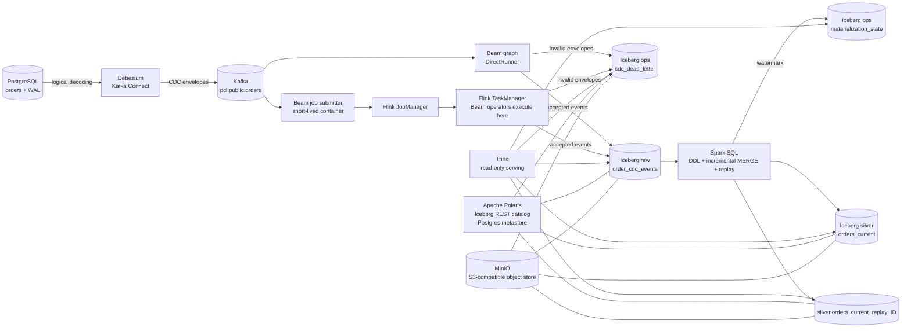
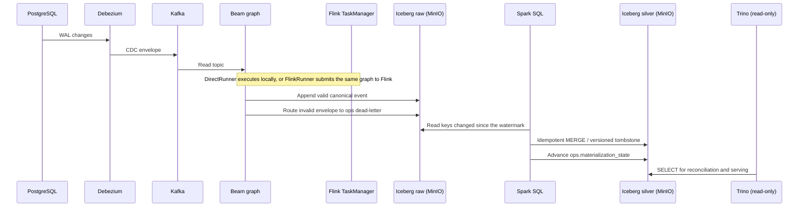

# 🧊 Portable CDC Lakehouse 🚀

### Open-source data engineering experiment with Apache Beam, Apache Spark, Flink and Iceberg

Portable CDC Lakehouse is a local Proof of Concept (POC) for capturing database changes, processing them as a stream, and storing both change history and current state in an open table format.

It uses PostgreSQL, Debezium, Kafka, Scala on the Beam Java SDK, Apache Spark, Apache Flink, Apache Iceberg, Apache Polaris, MinIO, and Trino. The same Beam graph has been exercised with DirectRunner and the classic FlinkRunner on separate JobManager and TaskManager containers. Batch transformation runs on Spark, and Trino is strictly read-only.

## ⚠️ Disclaimer

This repository is an open-source engineering experiment intended for learning and architectural exploration. It is a POC, not a production-ready data platform. It does not provide production availability, security hardening, recovery guarantees, performance SLAs, or end-to-end exactly-once delivery.

## 🎯 Project goal

The goal is to make the path from a relational database change to an auditable lakehouse table visible and reproducible. The POC focuses on the boundaries that are easy to get wrong in streaming systems: CDC envelope normalization, source-position ordering, duplicate delivery, delete tombstones, replay, the interaction between Beam runners and Iceberg storage, and the separation between batch transformation and read-only serving.

## ⚖️ Why this architecture

PostgreSQL answers *what is the state now*. This POC also answers *how did it get here, and can I rebuild it*.

| Question | Querying PostgreSQL directly | This POC |
|---|---|---|
| What is the current state? | Yes, simple and fast | Yes, in `silver` |
| What changed, and when? | No, only the live row | Yes, append-only `raw` with before/after images |
| What happened to deleted rows? | No, they are gone | Yes, versioned tombstones |
| Can I reprocess after a rule or bug fix? | No, the changes are lost | Yes, rebuild `silver` from `raw` |
| Can analytics run without loading the operational database? | No, they compete with the application | Yes, Trino and Iceberg |
| Can several consumers read the same stream? | No, they couple to the database | Yes, one Kafka stream, many readers |
| Can I read the table as of a past snapshot? | No | Yes, Iceberg snapshots |

The point is not to read better: it is to **reconstruct, audit, and analyze without touching the operational system**.

The trade-off is explicit: more moving parts (Kafka, Flink, Spark, Iceberg, Polaris, Trino), seconds of latency, and duplicated storage. For a small dataset that only needs the current row, a direct `SELECT` is the better engineering choice.

## ✨ Key highlights

- 🐘 Capture PostgreSQL changes from the WAL with Debezium.
- 📨 Publish CDC events to Kafka and consume them with a Beam graph.
- 🔀 Run the graph with DirectRunner or submit it to a separate Flink cluster.
- 🧾 Keep append-only CDC history in Iceberg on MinIO.
- 🪦 Project the history into one current-state row per order, preserving deletes as versioned tombstones.
- ⚡ Transform with Spark SQL: Iceberg DDL, an incremental `MERGE`, and replay.
- 🔁 Replay raw history into an isolated Iceberg table.
- 🔎 Serve with Trino, which is configured read-only at the engine level.
- 📦 Run local dependencies with Podman; operate the POC through Rake commands.

## 🏗️ Architecture



### 🔄 Runtime flow

1. PostgreSQL writes changes to its logical WAL. Debezium reads those changes and publishes envelopes to Kafka.
2. Beam reads the topic, ignores Kafka's null-value delete markers, normalizes Debezium envelopes, and routes valid events to raw history and invalid envelopes to the dead-letter table.
3. With DirectRunner, the Beam process executes locally in its temporary container. With FlinkRunner, that container submits the job and waits while Flink executes Beam operators in the TaskManager. The streaming job checkpoints every 10 seconds with RocksDB and externalized checkpoints, so a restart has a durable state snapshot. In continuous mode, the submitter and Flink services stay active until the job is stopped.
4. Spark SQL materializes `silver.orders_current`. It reads the watermark from `ops.materialization_state`, selects the keys that received arrivals since the last run, re-ranks the full history of only those keys, applies an idempotent `MERGE`, and advances the watermark after the commit. Deletes become versioned tombstones. Raw rows are deduplicated by `event_id` before ranking, because Kafka delivery is at-least-once.
5. `lakehouse:replay` drops and recreates an isolated target table with Spark and rebuilds it from all raw events or an inclusive LSN range. It does not update the canonical current-state table or the watermark.
6. Trino only reads: it inspects the Iceberg tables, snapshots, counts, and reconciliation discrepancies. Its access control rejects every write operation.



## 🧰 Technologies and why they were chosen

### 🐘 PostgreSQL — operational source

PostgreSQL represents the application database whose changes need to reach the lakehouse. Its logical WAL gives Debezium a change stream to capture, while the sample `orders` table keeps the POC grounded in normal relational data. The current implementation focuses on one PostgreSQL source and the `orders` entity.

### 🔌 Debezium and Kafka Connect — CDC capture

Debezium reads the PostgreSQL WAL and emits structured change envelopes, including an initial snapshot and subsequent creates, updates, and deletes. This avoids implementing a custom database poller and gives the pipeline source metadata it can use for ordering. Kafka Connect hosts and manages the connector.

### 📨 Apache Kafka — decoupled event transport

Kafka buffers the CDC stream between the source connector and Beam. This lets capture and processing run independently and gives consumers a replayable topic. The local broker uses KRaft, so the single-node POC does not need ZooKeeper. This setup demonstrates the integration path; it is not a highly available Kafka deployment.

### 🧠 Scala and Apache Beam — shared processing graph

The pipeline is written in Scala 2.13 using Beam's Java SDK. Beam provides one graph for reading Kafka, normalizing and validating events, routing invalid input, and writing Iceberg rows. Keeping those transforms in a Beam graph makes runner portability demonstrable. Beam does not publish a separate official Scala SDK, so Scala/JVM serialization and classloading are explicit compatibility concerns in this POC.

### 🏃 DirectRunner and FlinkRunner — local and distributed execution

DirectRunner executes the graph locally and is useful during development. The classic FlinkRunner submits the same JVM graph to the local Flink JobManager; Flink schedules and executes the operators in the TaskManager. This makes the persistent distributed runtime visible in Podman while keeping the business transforms shared. A separate Beam worker service is not required for this classic JVM runner. The continuous Flink job has been verified running; result-by-result equivalence between runners remains open.

### ⚡ Apache Spark — batch transformation layer

Spark owns everything that writes `silver`: the Iceberg DDL, the incremental `MERGE` from `raw`, and the replay rebuild. It runs as a one-shot `spark-sql` container on the Compose network, so the POC needs no long-lived cluster; the image is built once with the Iceberg runtime baked in. Keeping transformation out of Beam avoids a stateful streaming job and a custom Iceberg sink, and keeping it out of Trino preserves the layer boundary: Trino serves, Spark transforms. The artifact that is portable here is the SQL, not a runner.

### 🧊 Apache Iceberg — open table format

Iceberg stores both the append-only event history and the current-state projection. The raw table preserves the sequence of accepted changes for inspection and replay. The silver table holds one row per order and records deletes as versioned tombstones so older changes cannot silently restore a deleted order. Beam appends to `raw`, Spark writes `silver`, and Trino reads both. Iceberg snapshots make committed table changes inspectable.

### 🗄️ MinIO — local S3-compatible object storage

MinIO gives Beam, Spark and Trino a shared S3 API endpoint without requiring a cloud account. Iceberg data files live in its persistent Podman volume. The POC builds a pinned upstream MinIO release locally because the upstream community container image is no longer published; this is documented as an implementation constraint.

### 📚 Apache Polaris — shared Iceberg REST catalog

Beam, Spark and Trino need to resolve the same Iceberg tables and snapshots. Apache Polaris provides the REST catalog endpoint, and its metadata lives in a dedicated `polaris` database inside the same PostgreSQL instance as the source (schema `polaris_schema`). That removes the SQLite fixture from the POC and makes catalog state survive container restarts. Polaris authenticates clients with OAuth2 client credentials; Beam, Spark and Trino exchange them for short-lived tokens. MinIO does not implement STS, so the catalog is created with `stsUnavailable=true` and credential vending disabled: each client uses its own S3 credentials for data files.

### 🔎 Trino — read-only serving layer

Trino is the serving layer: it answers business queries, reconciliation, and snapshot inspection. It does not create tables, merge, or replay. The POC mounts Trino's built-in `read-only` system access control, so `INSERT`, `CREATE`, `MERGE`, `DROP`, and `ALTER` are rejected by the engine even if they arrive from the CLI, a notebook, or a BI tool. `rake query:file` adds an allowlist on top of that boundary for a clearer error message.

### 📦 Podman, Compose, and Rake — reproducible local operations

Podman runs the services and job containers without requiring Docker Engine. Compose describes the pinned services, named data volumes, and optional Flink cluster. Rake provides repeatable commands for startup/readiness, builds, pipeline submission, replay, queries, and shutdown. These tasks orchestrate the workflow; they are not additional runtime services.

### 📌 Pinned versions and validation

| Component | Version | Validation |
|---|---|---|
| Podman / podman-compose | 5.8.2 / 1.5.0 | Local stack started and exercised |
| Build image / JDK | `scala-sbt:eclipse-temurin-21.0.12_8_1.13.0_2.13.18` / Temurin 21.0.12+8 | Build and test gate |
| Scala / sbt | 2.13.18 / 1.13.0 | Compile and tests |
| Apache Beam / DirectRunner | 2.76.0 | Bounded Kafka-to-Iceberg run |
| Beam FlinkRunner / Apache Flink | 2.76.0 (`beam-runners-flink-2.2`) / 2.2.1 | Bounded job completed on Podman JobManager and TaskManager |
| Apache Spark | 3.5.9 (Scala 2.12, Java 17) | Iceberg DDL, incremental MERGE, replay |
| Iceberg Spark runtime / AWS bundle | 1.11.0 | Baked into the Spark image, no runtime downloads |
| PostgreSQL / Kafka | 17.2 / 3.9.1 | Source CDC and topic exercised |
| Debezium Connect | 3.2.4.Final | PostgreSQL connector task reached RUNNING |
| Apache Iceberg | 1.11.0 | Beam write, Spark transform, Trino read |
| Apache Polaris | 1.8.0 | OAuth2 catalog API, Postgres metastore, MinIO storage |
| Trino | 476 | Read-only queries, reconciliation, snapshot inspection |
| MinIO | `RELEASE.2025-10-15T17-29-55Z`, built with Go 1.24.8 | Bucket and Iceberg object writes exercised |
| AWS CLI | 2.27.41 | MinIO bucket bootstrap |

The FlinkRunner artifact family matches Flink 2.2.x, and [Beam's compatibility table](https://beam.apache.org/documentation/runners/flink/) lists support for Beam 2.75.0 and later with that runner family. The compatibility evidence above is specific to this local pinned stack; it does not claim production-cluster validation.

## 🗂️ Data model and semantics

| Table | Purpose | Important behavior |
|---|---|---|
| `raw.order_cdc_events` | Canonical append-only history | Stores source, key, operation, source position, before/after images, snapshot flag, `source_timestamp`, `connector_timestamp`, `raw_reference` (`topic:partition:offset`), batch ID, and event ID. |
| `silver.orders_current` | Current state for each order | One row per order; latest source position wins; deletes remain as `is_deleted=true` tombstones; `last_operation` and `last_source_timestamp` describe the winning event. |
| `ops.cdc_dead_letter` | Invalid input inspection | Stores the reason code and payload for invalid Debezium envelopes. |
| `ops.materialization_state` | Incremental watermark | One row per target table; `last_ingested_at` is the arrival bound already folded into the projection. |
| `silver.orders_current_replay_<id>` | Isolated replay result | A run-scoped target created by `rake lakehouse:replay`; the canonical projection is left untouched. |

Ordering uses LSN, then the numeric transaction id, then the intra-transaction `sequence` ordinal, then the deterministic event id. Event time and arrival time are not used as the sole precedence rule. Snapshot rows are marked distinctly; deterministic event IDs include the primary key because PostgreSQL snapshot rows can share a source position.

`raw.order_cdc_events` is append-only by design. At-least-once Kafka delivery or a restart without committed offsets can append the same `event_id` more than once; materialization and reconciliation therefore deduplicate by `event_id` before ranking, keeping the newest `ingested_at` copy. The duplicate-delivery report in `sql/trino/reconciliation.sql` makes that visible instead of hiding it.

`lakehouse:materialize` is incremental. It uses `ingested_at` (arrival) to find the keys that changed since the last successful run, then re-ranks the full history of only those keys. Source order still decides the winner, so a late event cannot overwrite a newer state. The watermark advances after the `MERGE` commits; a failed run is reprocessed, and the `MERGE` is idempotent. A replay is a full rebuild by definition and never touches the watermark.

## 🛠️ Correctness fixes applied

The first version of the POC exposed several correctness problems. They were fixed in the code and, where possible, covered by tests:

| Problem | Correction |
|---|---|
| Debezium's PostgreSQL field is `sequence`, not `sequenceNo` | `DebeziumSource` decodes `sequence`, tolerates a stringified array or a real array, and exposes the last numeric element as `sequenceNo`. |
| The top-level `ts_ms` was used as the database change time | `sourceTimestamp` now comes from `source.ts_ms`; the top-level value is stored separately as `connectorTimestamp`. |
| Transaction ids were compared as strings (`"999"` > `"1000"`) | `SourcePosition.comparePosition` parses numeric transaction ids and falls back to string comparison only for non-numeric ids. |
| Primary-key columns were hard-coded to `order_id` | `PCL_PRIMARY_KEY_COLUMNS` configures the key columns passed to the normalizer. |
| `raw_reference` was never populated | The Kafka reader now sets it to `topic:partition:offset` for accepted and rejected records. |
| The Flink job had no checkpointing | The cluster and the Beam submission use 10-second `EXACTLY_ONCE` checkpoints, RocksDB state, and externalized checkpoints. |
| Append-only history could contain duplicate events | Materialization and reconciliation deduplicate by `event_id` before ranking; the duplicate report surfaces repeated delivery. |
| Replay reused an existing table | `lakehouse:replay` drops and recreates its isolated target on every run. |
| Trino ran the DDL, the `MERGE` and the replay, mixing transformation with serving | Transformation moved to Spark SQL; Trino is mounted with the read-only access control, and `query:file` rejects writes. |
| Every materialization rescanned and re-ranked the whole history | `ops.materialization_state` limits each run to the keys with new arrivals; replay remains a full rebuild. |
| Polaris `catalog_admin` does not include data-write, and drop-with-purge is off by default, so only the first replay could drop its target | `polaris-setup` grants `CATALOG_MANAGE_CONTENT` and sets `polaris.config.drop-with-purge.enabled=true` on the catalog, so drops with purge work on every run. |
| Reconciliation only compared key counts | It now compares business columns, tombstone state, operation, and source position, and a full replay must match the live projection exactly. |

## 🚀 Quick start

From Windows PowerShell, copy `.env.example` to `.env` and set the local PostgreSQL, MinIO, and Polaris passwords. Start the services and prepare the CDC source:

```powershell
Copy-Item .env.example .env
bundle exec rake infra:up          # starts Postgres, Kafka, MinIO, Polaris, Connect, Trino
bundle exec rake lakehouse:init    # Spark creates the raw/silver/ops Iceberg tables
bundle exec rake debezium:register # registers the PostgreSQL connector
bundle exec rake fixtures:scenarios
```

`infra:up` starts PostgreSQL first, ensures the `polaris` database and `polaris_schema` exist, then starts the rest of the stack. The one-shot `polaris-setup` container creates the `pcl` catalog idempotently. Polaris listens on `http://localhost:8181/api/catalog`; its health endpoint is `http://localhost:8182/q/health`. The first `lakehouse:init` builds the pinned Spark image locally; later runs reuse it.

Launch the unbounded Beam job. It keeps reading CDC events from Kafka and writing them to Iceberg until you stop the Flink cluster:

```powershell
$env:PCL_MAX_RECORDS = '0'
bundle exec rake pipeline:flink
```

This command stays attached while the job runs. Open the Flink dashboard at [localhost:8081](http://localhost:8081). To stop the job from a second PowerShell window, run `bundle exec rake pipeline:flink:stop`.

The `silver.orders_current` projection is refreshed separately with Spark; in a second window, run `bundle exec rake lakehouse:materialize` when you want to update it, then inspect it with `bundle exec rake query:file[sql/trino/reconciliation.sql]`.

## 📸 Results from the running POC

The outputs below come from the session on 27 October 2026; the Flink dashboard screenshots are from the continuous run of the same job on 26 October. The Beam graph ran with DirectRunner and with the FlinkRunner, both writing to the same Iceberg tables through Apache Polaris, and Spark then transformed that history.

### 1. Apache Polaris owns the catalog

`rake infra:up` starts PostgreSQL first, creates the `polaris` database and schema, bootstraps the `POLARIS` realm, creates the `pcl` catalog, grants the content privilege and catalog setting that drop-with-purge needs, and only then starts Trino. Every step is idempotent:

```text
$ rake infra:up
Created MinIO bucket 'pcl-warehouse'.

All services ready.
  Trino    http://localhost:8080
  Connect  http://localhost:8083
  MinIO    http://localhost:9001
  Polaris  http://localhost:8181/api/catalog
  Polaris health  http://localhost:8182/q/health
```

```text
$ podman logs pcl-polaris-bootstrap
Realm 'POLARIS' successfully bootstrapped.
Bootstrap completed successfully.

$ podman logs pcl-polaris-setup
Requesting a Polaris access token...
Polaris catalog 'pcl' already exists.
Polaris catalog role 'catalog_admin' already holds CATALOG_MANAGE_CONTENT.
Polaris catalog 'pcl' already enables drop-with-purge.
```

On a fresh volume the same setup container prints `Created Polaris catalog 'pcl' at s3://pcl-warehouse/warehouse/.`; the lines above are the idempotent re-run.

The realm is stored in PostgreSQL, and the health endpoint reports `UP`:


### 2. Both runners process the same CDC stream

Debezium reports the connector and its single task as `RUNNING`:

```json
{"name":"pcl-postgres-orders","connector":{"state":"RUNNING"},"tasks":[{"id":0,"state":"RUNNING"}],"type":"source"}
```

The bounded DirectRunner pass read 15 Kafka records, accepted 13, and counted 2 Kafka tombstones (the key-only delete markers Debezium emits, which carry no payload). It wrote one Iceberg data file:

```text
elements_read=15  accepted_events=13  kafka_tombstones=2  dataFilesWritten=1
```

The FlinkRunner job started from the earliest offset because no consumer offsets were committed, so it appended a second batch of 13 accepted events. A third bounded pass, used for the dead-letter check below, appended the same 13 events once more. The audit table now holds 39 rows for 13 distinct event ids, which is the at-least-once behavior the projection is designed to absorb.

In this session both passes were bounded to 15 records. The screenshots below come from the earlier continuous run of the same job, which stayed up long enough to accumulate checkpoints:


85 checkpoints completed; the latest one acknowledged 5/5 subtasks at 421 KB and was written to the external checkpoint directory. The six failures in the history are the first triggers while the job was still deploying (`Not all required tasks are currently running`), not state failures:


### 3. Spark materializes through Polaris

`rake lakehouse:init` creates the namespaces and tables with a one-shot `spark-sql` container, and `rake lakehouse:materialize` applies the incremental `MERGE`. Both talk to the same Polaris REST catalog as Beam and Trino:

```text
$ rake lakehouse:init
$ podman run --rm --network pcl_default ... localhost/pcl-spark:3.5.9-iceberg-1.11.0 \
    /opt/spark/bin/spark-sql --properties-file /opt/pcl/conf/spark-defaults.conf -f /opt/pcl/conf/work/bootstrap_catalog.sql
Spark master: local[*], Application Id: local-1793131197113
Time taken: 5.53 seconds
Time taken: 0.065 seconds
Time taken: 0.078 seconds
Time taken: 0.525 seconds
Time taken: 0.169 seconds
Time taken: 0.102 seconds
Time taken: 0.112 seconds
Iceberg tables ready (spark-sql, catalog pcl).
```

The first materialization after the DirectRunner batch read the watermark (epoch) and rescanned the seven changed keys. Each later pass rescanned the same seven keys, because their events had arrived again, and converged on the same result. The `MERGE` is idempotent but not free: Spark rewrites the files that contain matched rows, so a run commits an overwrite snapshot even when no business value changes.

```text
$ rake lakehouse:materialize
$ podman run --rm --network pcl_default ... localhost/pcl-spark:3.5.9-iceberg-1.11.0 \
    /opt/spark/bin/spark-sql --properties-file /opt/pcl/conf/spark-defaults.conf -f /opt/pcl/conf/work/materialize_orders.sql
Spark master: local[*], Application Id: local-1793132074739
Time taken: 7.515 seconds
Time taken: 0.265 seconds
Time taken: 0.366 seconds
Time taken: 0.332 seconds
Time taken: 0.613 seconds
changed_keys	7
Time taken: 15.706 seconds, Fetched 1 row(s)
projected_keys	7
Time taken: 6.102 seconds, Fetched 1 row(s)
Time taken: 18.167 seconds
Time taken: 2.344 seconds
Current-state projection refreshed (spark-sql, catalog pcl).
```

```text
$ rake lakehouse:describe

== tables
ops | cdc_dead_letter
ops | materialization_state
raw | order_cdc_events
silver | orders_current
silver | orders_current_replay_readme_proof

== current-state snapshots
4705716679392310919 | overwrite | 2026-10-27 20:15:40.567 UTC
1414936190202702993 | overwrite | 2026-10-27 19:58:06.729 UTC
1580568179560580880 | overwrite | 2026-10-27 19:47:57.356 UTC
319887680504692394  | overwrite | 2026-10-27 19:45:20.538 UTC
6413925175051381393 | append    | 2026-10-27 19:36:03.249 UTC

== materialization watermark
silver.orders_current | 2026-10-27 20:13:11.514 UTC | 2026-10-27 20:15:40.854 UTC
```

Trino cannot write, and it is the engine that enforces it:

```text
$ curl -X POST localhost:8080/v1/statement -d 'CREATE TABLE iceberg.silver.readonly_probe (x BIGINT)'
Access Denied: Cannot create table iceberg.silver.readonly_probe

$ rake "query:file[.local/readonly_probe.sql]"
query:file is read-only and cannot run CREATE.
Allowed: SELECT, WITH, SHOW, DESCRIBE, DESC, EXPLAIN, VALUES, TABLE.
Writes belong to Spark: rake lakehouse:init, lakehouse:materialize, lakehouse:replay.
```

Polaris prefixes each table location with a UUID. The raw table's Parquet and metadata files are visible in the MinIO object browser:


### 4. Reconciliation and replay

Reconciliation deduplicates by `event_id`, reports the repeated delivery explicitly, and still finds zero discrepancies:

```text
-- 1. Live vs deleted split of the projection.
false | 6
true  | 1

-- 2. Duplicate delivery report.
13 | 26

-- 5. Discrepancy report.
1001 | 31464144 | 31464144 | UPDATE | UPDATE | false | false | ok
1002 | 31464704 | 31464704 | UPDATE | UPDATE | false | false | ok
1003 | 31464104 | 31464104 | SNAPSHOT_READ | SNAPSHOT_READ | false | false | ok
1004 | 31464816 | 31464816 | DELETE | DELETE | true | true | ok
1005 | 31464960 | 31464960 | CREATE | CREATE | false | false | ok
1006 | 31465512 | 31465512 | CREATE | CREATE | false | false | ok
1007 | 31465960 | 31465960 | UPDATE | UPDATE | false | false | ok
```

A full replay into an isolated table reproduces the live projection exactly:

```text
$ $env:PCL_REPLAY_ID='readme_proof'; rake lakehouse:replay
Replay readme_proof materialized to pcl.silver.orders_current_replay_readme_proof: 7 keys, 1 tombstones.
Full replay readme_proof matches silver.orders_current exactly.
```

A bounded replay applies the same logic to an inclusive LSN window, so the target holds only the keys that changed inside it:

```text
$ $env:PCL_REPLAY_ID='window_probe'
$ $env:PCL_REPLAY_FROM_LSN='31464100'; $env:PCL_REPLAY_TO_LSN='31465000'
$ rake lakehouse:replay
Replay window_probe materialized to pcl.silver.orders_current_replay_window_probe: 5 keys, 1 tombstones.
```

```text
SELECT order_id, status, is_deleted, last_lsn
  FROM iceberg.silver.orders_current_replay_window_probe ORDER BY order_id;

1001 | PAID | false | 31464144
1002 | PAID | false | 31464704
1003 | NEW  | false | 31464104
1004 |      | true  | 31464816
1005 | NEW  | false | 31464960
```

Orders 1006 and 1007 are absent because their events fall outside the window. A bounded replay is a partial history by construction, so `lakehouse:replay` reports its shape instead of asserting equality with the live projection.

### 5. Invalid envelopes are quarantined, not dropped

Four deliberately invalid envelopes were published to the same Kafka topic: truncated JSON, an unknown `op`, a delete with no row image, and an update with no primary key. The next bounded pass read 19 records, accepted 13, and rejected 4:

```text
elements_read=19  accepted_events=13  rejected_events=4  kafka_tombstones=2  dataFilesWritten=1
```

Each rejection keeps a stable reason code, the original payload, and the run that observed it:

```text
-- 7. Dead letter overview, by reason code.
INCONSISTENT_PAYLOAD | 1
MALFORMED_JSON       | 1
MISSING_PRIMARY_KEY  | 1
UNKNOWN_OPERATION    | 1

MALFORMED_JSON       | - | {"op":"c","after":
UNKNOWN_OPERATION    | - | {"op":"x","after":{"order_id":9001,"status":"GHOST"}
INCONSISTENT_PAYLOAD | - | {"op":"d","source":{"db":"pcl","schema":"public","ta
MISSING_PRIMARY_KEY  | - | {"op":"u","after":{"status":"NO_KEY"},"source":{"db"
```

`event_id` is empty on purpose: the envelope never reached identity derivation, so there is no canonical id to attach. The payload and the Kafka reference are what make the record diagnosable, and none of the four reached `raw` or `silver`.

### 6. Terminal evidence

A single capture of the commands behind the state above, from `infra:up` to the read-only rejection:


## 🔎 What this evidence proves

- PostgreSQL CDC events travel through Debezium and Kafka into Beam, and the FlinkRunner job runs on the local Flink cluster with checkpointing enabled.
- Spark creates the Iceberg tables, applies the incremental `MERGE`, and rebuilds the projection on replay, all through Apache Polaris; deletes are represented as tombstones.
- Trino is read-only: it answers reconciliation and inspection queries, and the engine rejects `CREATE`, `INSERT`, `MERGE`, `DROP`, and `ALTER`.
- Reconciliation compares business columns, tombstone state, operation, and source position, not only key counts. A full replay must match the live projection exactly, and a bounded replay contains only the keys inside its LSN window.
- Raw history is append-only. Repeated delivery is expected under at-least-once processing and is handled by deduplicating on `event_id`; the duplicate report makes it visible.
- Invalid envelopes never reach `raw` or `silver`: they land in `ops.cdc_dead_letter` with a stable reason code, the original payload, and the run that saw them, and the pipeline keeps going.

This is a **proof of concept**, not a production-ready platform. Restart/recovery behavior is exercised at the checkpoint-configuration level, not through a sustained failure-injection campaign. Performance benchmarking, schema evolution, and a second source table remain unvalidated. Exactly-once processing and production throughput are not claimed.

## 📜 License

See [LICENSE](LICENSE).
